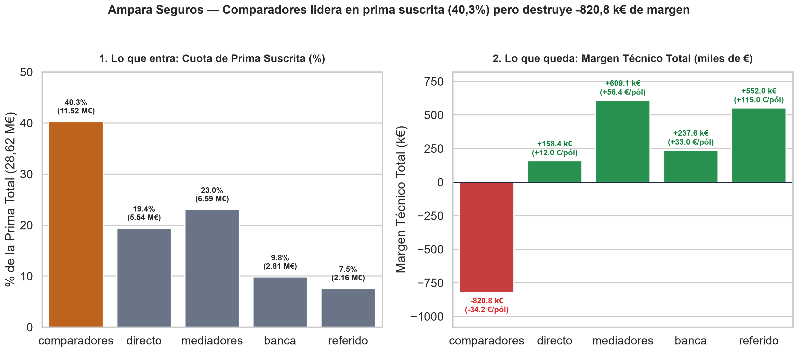
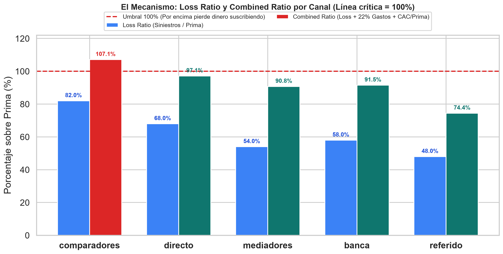
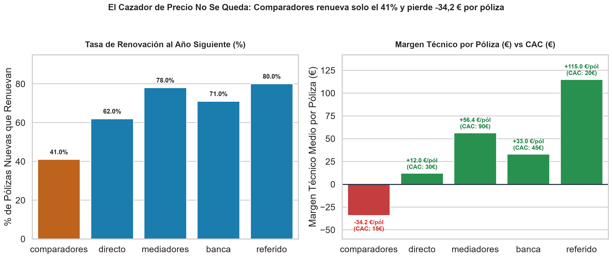
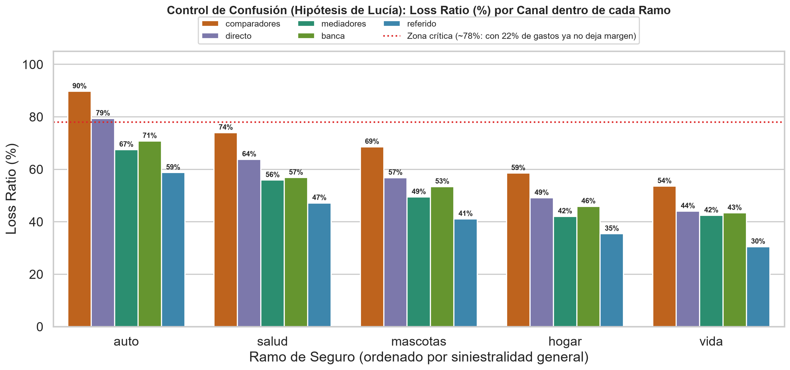

🇲🇽 [Versión en español](README.md)

# Ampara — Insurance

**Business question:** Which acquisition channel pays for what it costs once claims, expenses and renewal are taken into account?

## Business context

Multi-line insurer allocating its annual budget across comparison sites, brokers, bancassurance, direct and referrals.

5-day case study ("real assignment" format): exploration, cleaning, SQL/Python analysis, discovery of the key insight, stress-testing against alternative hypotheses, and executive communication.

## Dataset

Synthetic case data in `data/` (14 CSV files; folders: `data/clean/`, `data/raw/`). `raw/` holds the original data and `clean/` the cleaned tables produced by the notebooks.

## Method (day by day)

| Notebook | Content |
|---|---|
| [`dia_01.ipynb`](dia_01.ipynb) | Day 1 — First contact with the data |
| [`dia_02.ipynb`](dia_02.ipynb) | Day 2 — Clean, and decide for yourself what margin means |
| [`dia_03.ipynb`](dia_03.ipynb) | Day 3 (Morning and Afternoon) — From the Surface Ranking to the First Crack: the Loss Ratio |
| [`dia_04.ipynb`](dia_04.ipynb) | Day 4 — Does it leave margin or cost more than it pays? |
| [`dia_05.ipynb`](dia_05.ipynb) | Day 5 — Make it understood and make it change something (Executive Visualizations and One-Pager for Marta) |

## Key findings

Faithful English translation of the opening section of the executive one-pager ([`reports/ONE_PAGER.md`](reports/ONE_PAGER.md), in Spanish); all figures come from the notebooks:

> ## 1. Executive Summary (In one sentence)
> **Comparison sites** look like the star channel on the growth dashboards because they bring **$40,0\%$ of new policies** ($24.000$), **$40,25\%$ of written premium** ($11,52\text{ M€}$) and the **lowest CAC** ($15\text{ €}$), but due to **adverse selection** (price hunters) they suffer a **Loss Ratio of $82,0\%$**, a **Combined Ratio of $107,1\%$** and a **renewal rate of just $41,0\%$**, making them the **only channel with a negative technical margin ($-34,20\text{ €/póliza}$)** and **subtracting $-820.800\text{ €}$** from Ampara's results (without them, Ampara would double its total technical margin from **$+736.320\text{ €}$** to **$+1.557.120\text{ €}$**).

Structure of the documented findings:

- 1. Executive Summary (In one sentence)
- 2. The Three Key Findings
- Finding 1 — Álex is right on the surface: comparison sites win on acquisition and volume
- Finding 2 — When crossed with claims, expenses and renewal, the ranking flips due to Adverse Selection
- Finding 3 — The number that decides the budget: a $-820.800\text{ €}$ hole versus channels that multiply margin
- 3. Master Channel Table (60.000 Valid New Policies)
- 4. Stress-Testing the Finding: Alternative Hypotheses Ruled Out
- 5. Actionable Recommendation for the Committee
- 6. Supporting Charts in `reports/`

## Charts









## Tools

Python 3, Pandas, NumPy, DuckDB (SQL), Matplotlib, Seaborn, Jupyter Notebook.

## How to run

```bash
pip install -r ../requirements.txt
cd ampara
jupyter notebook
```

Run the notebooks in order (`dia_01` → `dia_05`); paths are relative to this folder. The notebooks already include their outputs, so they can be read directly on GitHub. (Notebooks are in Spanish.)
