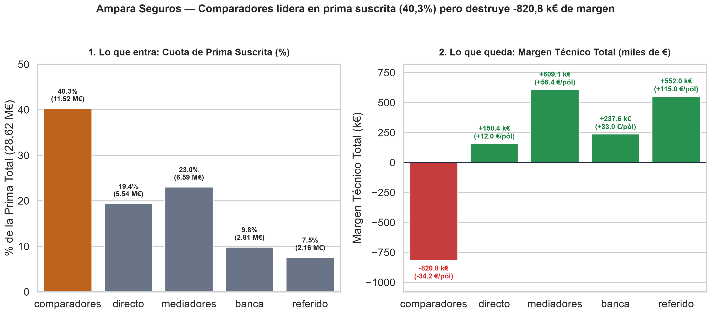
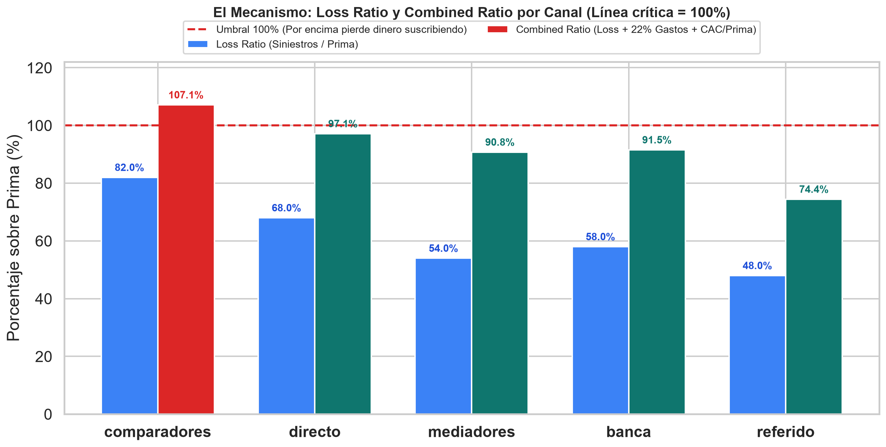
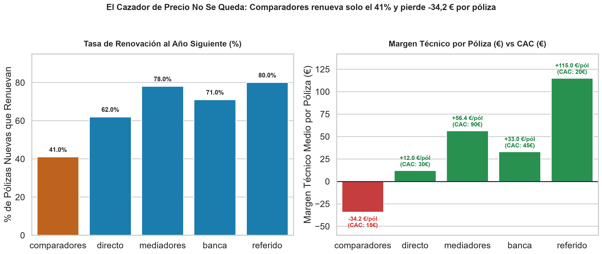
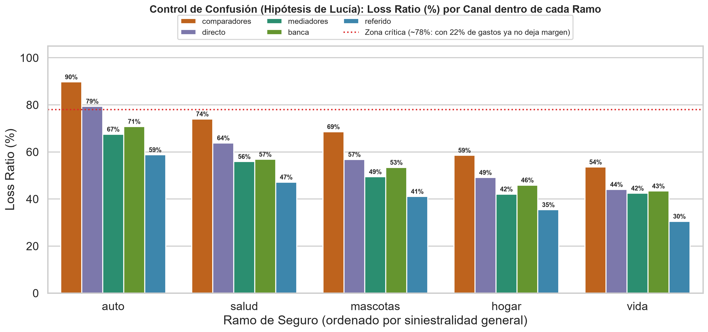

🇬🇧 [English version](README.en.md)

# Ampara — Seguros

**Pregunta de negocio:** ¿Qué canal de captación paga lo que cuesta una vez considerados siniestros, gastos y renovación?

## Contexto de negocio

Aseguradora multirramo que reparte su presupuesto anual entre comparadores, mediadores, banca, directo y referidos.

Caso de estudio de 5 días (formato «encargo real»): exploración, limpieza, análisis en SQL/Python, descubrimiento del hallazgo, blindaje frente a hipótesis alternativas y comunicación ejecutiva.

## Dataset

Datos sintéticos del caso en `data/` (14 ficheros CSV; carpetas: `data/clean/`, `data/raw/`). `raw/` contiene los datos originales y `clean/` las tablas limpias generadas por los cuadernos.

## Método (día a día)

| Cuaderno | Contenido |
|---|---|
| [`dia_01.ipynb`](dia_01.ipynb) | Día 1 — Primer contacto con los datos |
| [`dia_02.ipynb`](dia_02.ipynb) | Día 2 — Limpiar, y decidir tú qué es el margen |
| [`dia_03.ipynb`](dia_03.ipynb) | Día 3 (Mañana y Tarde) — Del Ranking de Superficie a la Primera Grieta: el Loss Ratio |
| [`dia_04.ipynb`](dia_04.ipynb) | Día 4 — ¿Deja margen o cuesta más de lo que paga? |
| [`dia_05.ipynb`](dia_05.ipynb) | Día 5 — Que se entienda y cambie algo (Visualizaciones Ejecutivas y One-Pager para Marta) |

## Hallazgos clave

Extracto literal del one-pager ejecutivo ([`reports/ONE_PAGER.md`](reports/ONE_PAGER.md)); todas las cifras provienen de los cuadernos:

> ## 1. Resumen Ejecutivo (En una frase)
> Los **comparadores** parecen el canal estrella en los paneles de crecimiento porque aportan el **$40,0\%$ de las pólizas nuevas** ($24.000$), el **$40,25\%$ de la prima suscrita** ($11,52\text{ M€}$) y el **CAC más bajo** ($15\text{ €}$), pero debido a la **selección adversa** (cazadores de precio) sufren un **Loss Ratio del $82,0\%$**, un **Combined Ratio del $107,1\%$** y una **renovación de apenas el $41,0\%$**, convirtiéndose en el **único canal con margen técnico negativo ($-34,20\text{ €/póliza}$)** y **restando $-820.800\text{ €}$** al resultado de Ampara (que sin ellos duplicaría su margen técnico total de **$+736.320\text{ €}$** a **$+1.557.120\text{ €}$**).

Estructura de los hallazgos documentados:

- 1. Resumen Ejecutivo (En una frase)
- 2. Los Tres Hallazgos Clave
- Hallazgo 1 — Álex tiene razón en la superficie: Comparadores gana en captación y volumen
- Hallazgo 2 — Al cruzar con siniestros, gastos y renovación, el ranking se invierte por Selección Adversa
- Hallazgo 3 — El número que decide el presupuesto: $-820.800\text{ €}$ de agujero frente a canales que multiplican el margen
- 3. Tabla Maestra de Canales (60.000 Pólizas Nuevas Válidas)
- 4. Blindaje del Hallazgo: Hipótesis Alternativas Descartadas
- 5. Recomendación Accionable para el Comité
- 6. Gráficos de Soporte en `reports/`

## Gráficos









## Herramientas

Python 3, Pandas, NumPy, DuckDB (SQL), Matplotlib, Seaborn, Jupyter Notebook.

## Cómo ejecutar

```bash
pip install -r ../requirements.txt
cd ampara
jupyter notebook
```

Ejecuta los cuadernos en orden (`dia_01` → `dia_05`); las rutas son relativas a esta carpeta. Los cuadernos ya incluyen sus salidas, por lo que se pueden leer directamente en GitHub.
