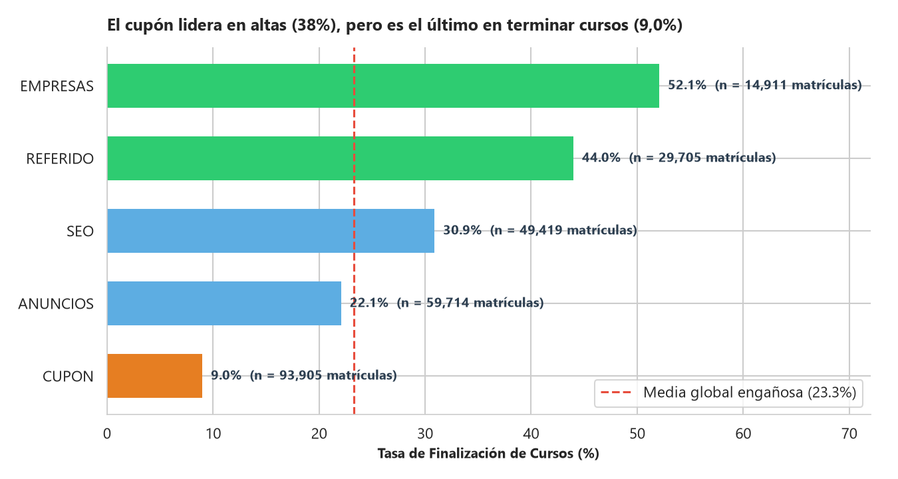
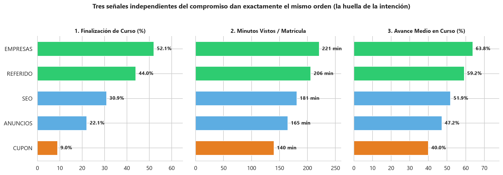
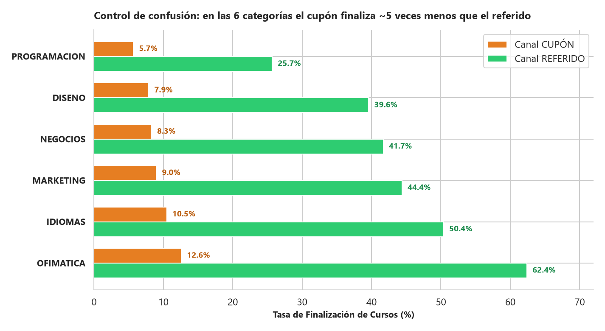
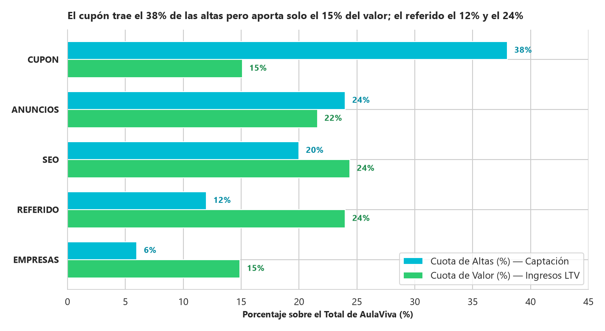
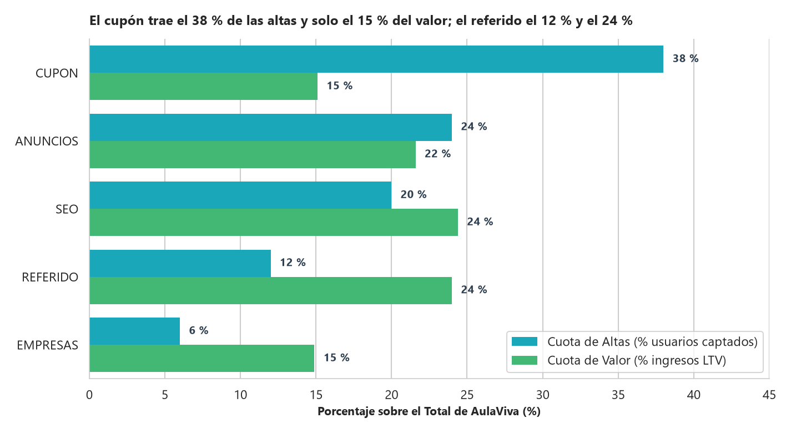
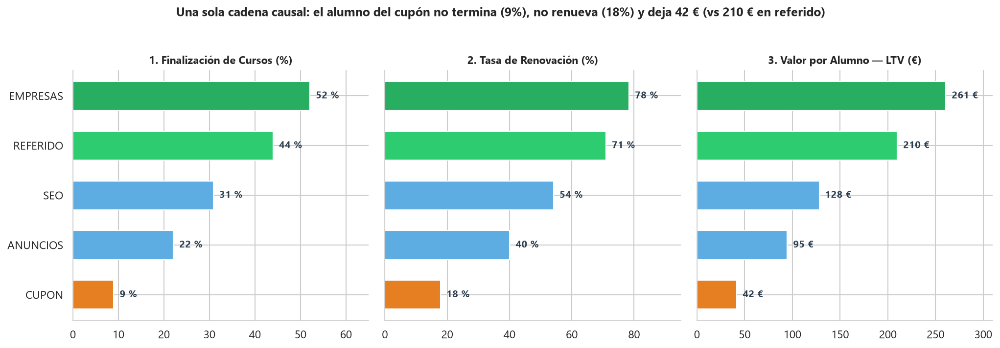
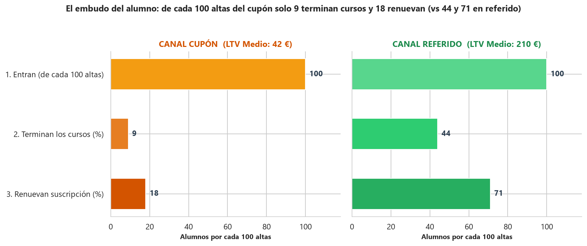
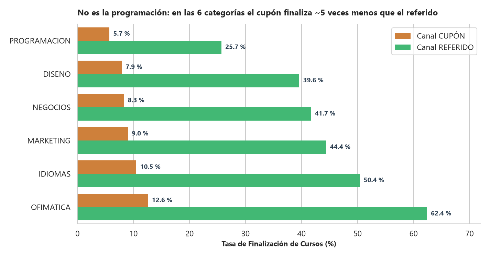

🇲🇽 [Versión en español](README.md)

# AulaViva — EdTech / Online courses

**Business question:** Which acquisition channel brings students who finish courses, renew and generate value? Should the coupon channel be scaled?

## Business context

Subscription-based online course platform that must allocate its quarterly acquisition budget across channels.

5-day case study ("real assignment" format): exploration, cleaning, SQL/Python analysis, discovery of the key insight, stress-testing against alternative hypotheses, and executive communication.

## Dataset

Synthetic case data in `data/` (14 CSV files; folders: `data/clean/`, `data/raw/`). `raw/` holds the original data and `clean/` the cleaned tables produced by the notebooks.

## Method (day by day)

| Notebook | Content |
|---|---|
| [`dia_01.ipynb`](dia_01.ipynb) | Day 1: Welcome to AulaViva and First Contact with the Data (Forensic EDA) |
| [`dia_02.ipynb`](dia_02.ipynb) | Day 2 (Morning and Afternoon): Clean Before Calculating (and Decide What Value Means) + The Surface Ranking in SQL |
| [`dia_03.ipynb`](dia_03.ipynb) | Day 3 (Morning): The First Crack — Completion by Channel and the Footprint of Intent |
| [`dia_04.ipynb`](dia_04.ipynb) | Day 4 (Thursday): Do They Learn and Renew, or Did They Just Get In Cheap? (The Discovery and Confounding Control) |
| [`dia_05.ipynb`](dia_05.ipynb) | Day 5 (Friday): Make It Understood and Make It Change Something (Executive Visualization and One-Pager for the Committee) |

## Key findings

Faithful English translation of the opening section of the executive one-pager ([`reports/ONE_PAGER.md`](reports/ONE_PAGER.md), in Spanish); all figures come from the notebooks:

> ## 1. EXECUTIVE RECOMMENDATION (The Decision First)
> **DO NOT pour this quarter's acquisition budget into scaling the Coupon channel.**  
> Instead, execute three moves:
> 1. **Redirect the growth budget toward the Referral program** (`LTV = 210 €`, `LTV/CAC = 21x`) and **reinforce high-intent organic channels such as SEO** (`LTV = 128 €`, `CAC = 0 €`).
> 2. **Limit Coupon to one-off tactical campaigns**, never as a structural growth pillar.
> 3. **Change the metric used to manage Growth in Looker:** stop rewarding sign-up volume and CAC in isolation, and start evaluating each channel by **Course completion, Renewal, LTV per student and Value Share**.

Structure of the documented findings:

- 1. EXECUTIVE RECOMMENDATION (The Decision First)
- 2. WHY, IN A SINGLE NUMBER
- 3. THE 4 FINDINGS BEHIND THE DECISION
- Finding 1 — Diego is right on the surface: Coupon leads in sign-ups and CAC
- Finding 2 — First crack on the surface: Coupon does NOT lead first-payment revenue
- Finding 3 — The central finding: a single causal chain (Low intent $\rightarrow$ Does not finish $\rightarrow$ Does not renew $\rightarrow$ Leaves little)
- Finding 4 — Confounding control: it is NOT the course catalog, the gap travels with the channel
- 4. DATA STRESS-TEST AND NEXT STEP IN LOOKER

## Charts

















## Tools

Python 3, Pandas, NumPy, DuckDB (SQL), Matplotlib, Seaborn, Jupyter Notebook.

## How to run

```bash
pip install -r ../requirements.txt
cd aulaviva
jupyter notebook
```

Run the notebooks in order (`dia_01` → `dia_05`); paths are relative to this folder. The notebooks already include their outputs, so they can be read directly on GitHub. (Notebooks are in Spanish.)
