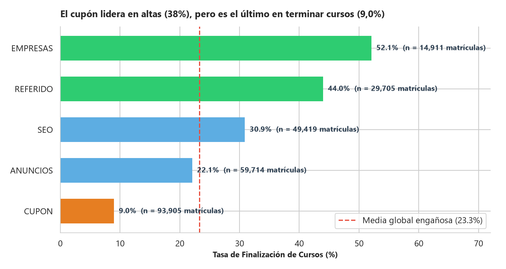
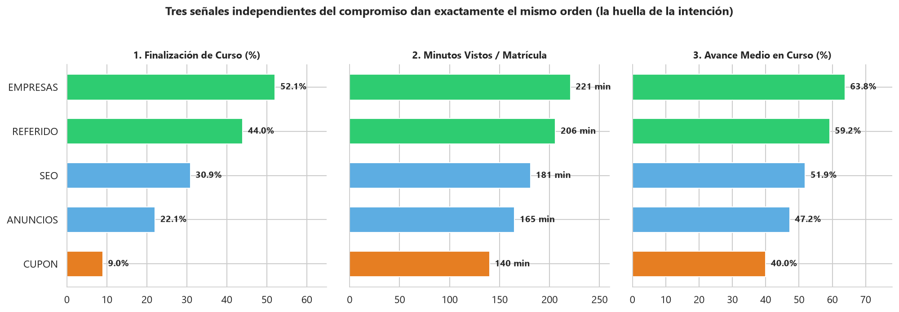
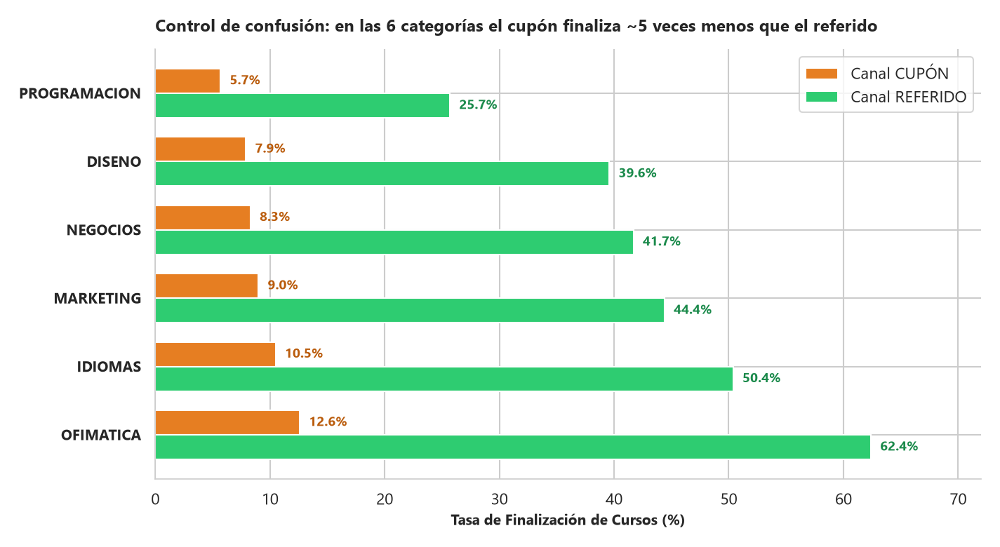
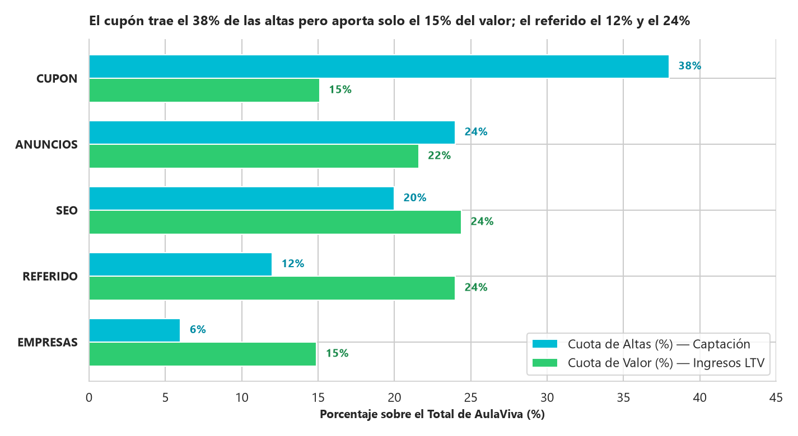
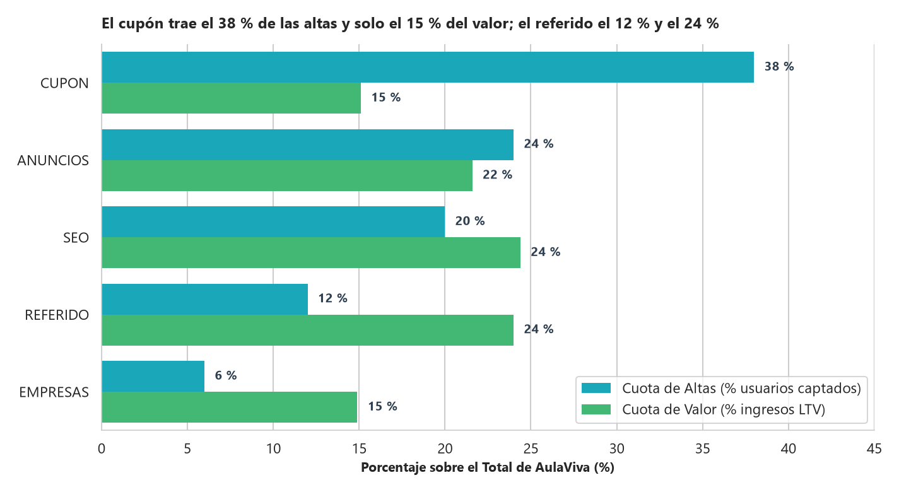
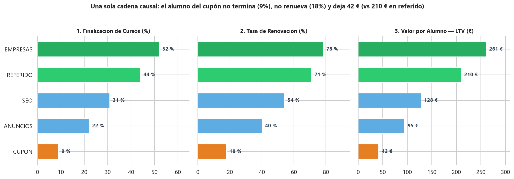
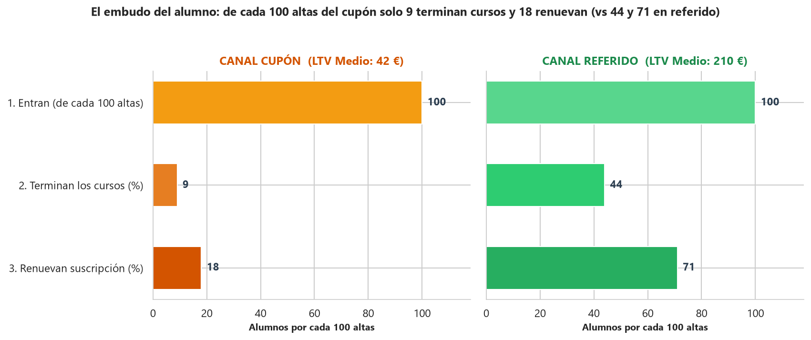
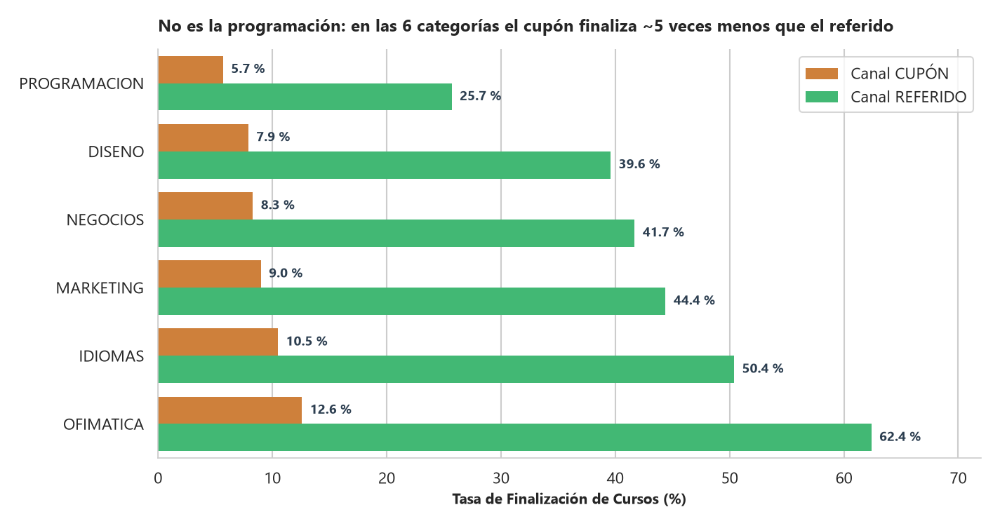

🇬🇧 [English version](README.en.md)

# AulaViva — EdTech / Cursos online

**Pregunta de negocio:** ¿Qué canal de captación trae alumnos que terminan cursos, renuevan y dejan valor? ¿Conviene escalar el canal de cupón?

## Contexto de negocio

Plataforma de cursos online por suscripción que debe repartir el presupuesto trimestral de captación entre canales.

Caso de estudio de 5 días (formato «encargo real»): exploración, limpieza, análisis en SQL/Python, descubrimiento del hallazgo, blindaje frente a hipótesis alternativas y comunicación ejecutiva.

## Dataset

Datos sintéticos del caso en `data/` (14 ficheros CSV; carpetas: `data/clean/`, `data/raw/`). `raw/` contiene los datos originales y `clean/` las tablas limpias generadas por los cuadernos.

## Método (día a día)

| Cuaderno | Contenido |
|---|---|
| [`dia_01.ipynb`](dia_01.ipynb) | Día 1: Bienvenida a AulaViva y Primer Contacto con los Datos (EDA Forense) |
| [`dia_02.ipynb`](dia_02.ipynb) | Día 2 (Mañana y Tarde): Antes de Calcular, Limpiar (y Decidir qué es el Valor) + El Ranking de Superficie en SQL |
| [`dia_03.ipynb`](dia_03.ipynb) | Día 3 (Mañana): La Primera Grieta — La Finalización por Canal y la Huella de la Intención |
| [`dia_04.ipynb`](dia_04.ipynb) | Día 4 (Jueves): ¿Aprende y Renueva, o Solo Entró Barato? (El Descubrimiento y el Control de Confusión) |
| [`dia_05.ipynb`](dia_05.ipynb) | Día 5 (Viernes): Que se Entienda y Cambie Algo (Visualización Ejecutiva y One-Pager para Comité) |

## Hallazgos clave

Extracto literal del one-pager ejecutivo ([`reports/ONE_PAGER.md`](reports/ONE_PAGER.md)); todas las cifras provienen de los cuadernos:

> ## 1. RECOMENDACIÓN EJECUTIVA (La Decisión Primero)
>
> **NO volcar el presupuesto de captación del trimestre en escalar el canal de Cupón.**  
> En su lugar, ejecutar tres movimientos:
> 1. **Redirigir el presupuesto de crecimiento hacia el programa de Referidos** (`LTV = 210 €`, `LTV/CAC = 21x`) y **reforzar los canales orgánicos de alta intención como SEO** (`LTV = 128 €`, `CAC = 0 €`).
> 2. **Acotar el Cupón a campañas tácticas puntuales**, nunca como eje estructural de crecimiento.
> 3. **Cambiar la métrica con la que se gobierna Growth en Looker:** dejar de premiar el volumen de altas y el CAC aislado, y pasar a evaluar cada canal por **Finalización de cursos, Renovación, LTV por alumno y Cuota de Valor**.

Estructura de los hallazgos documentados:

- 1. RECOMENDACIÓN EJECUTIVA (La Decisión Primero)
- 2. POR QUÉ, EN UNA SOLA CIFRA
- 3. LOS 4 HALLAZGOS QUE SOSTIENEN LA DECISIÓN
- Hallazgo 1 — Diego tiene razón en la superficie: el Cupón lidera en altas y en CAC
- Hallazgo 2 — Primera grieta en la superficie: el ingreso de primeras cuotas NO lo lidera el Cupón
- Hallazgo 3 — El hallazgo central: una sola cadena causal (Baja intención $\rightarrow$ No termina $\rightarrow$ No renueva $\rightarrow$ Deja poco)
- Hallazgo 4 — Control de confusión: NO es la programación, la brecha viaja con el canal
- 4. BLINDAJE DE DATOS Y PRÓXIMO PASO EN LOOKER

## Gráficos

















## Herramientas

Python 3, Pandas, NumPy, DuckDB (SQL), Matplotlib, Seaborn, Jupyter Notebook.

## Cómo ejecutar

```bash
pip install -r ../requirements.txt
cd aulaviva
jupyter notebook
```

Ejecuta los cuadernos en orden (`dia_01` → `dia_05`); las rutas son relativas a esta carpeta. Los cuadernos ya incluyen sus salidas, por lo que se pueden leer directamente en GitHub.
