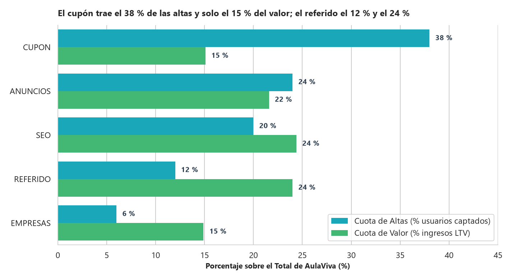
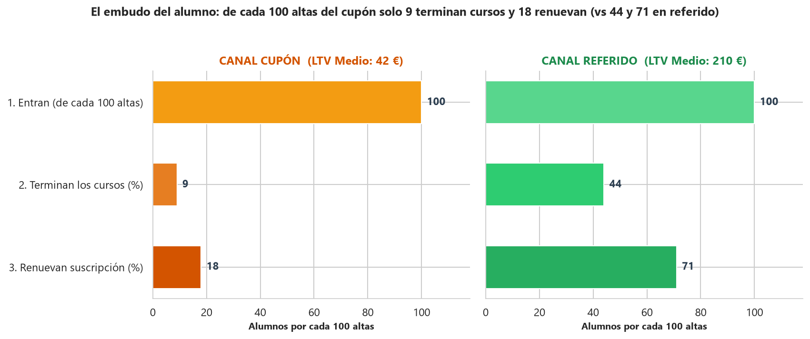
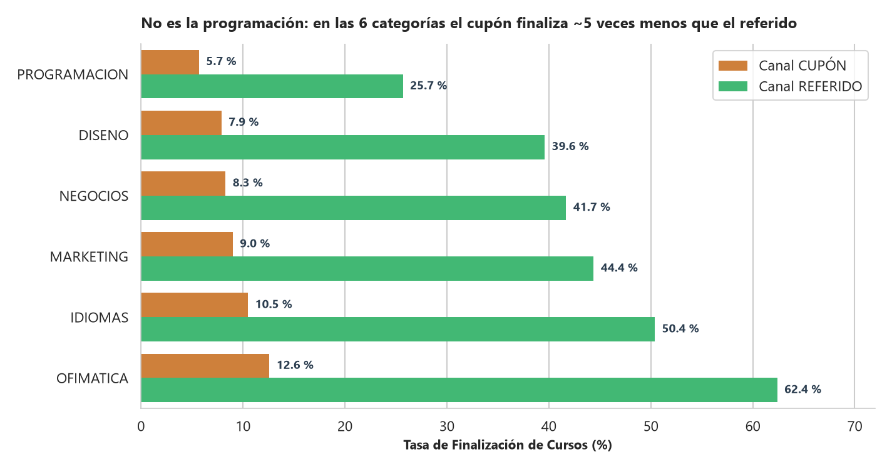

# AULAVIVA · ¿ESCALAMOS EL CANAL DE CUPÓN? · Analítica · Viernes
**Destinatarios:** Elena Sanchís (CEO), Diego Losada (Director de Growth), Paula Rivas (Head de Producto Educativo), Nuria Aguilar (Lead de Analítica)  
**Autor:** Analítica de Datos (AulaViva)  
**Asunto:** Evaluación de retorno y valor a largo plazo (LTV) por canal para el presupuesto de captación del trimestre  

---

## 1. RECOMENDACIÓN EJECUTIVA (La Decisión Primero)

**NO volcar el presupuesto de captación del trimestre en escalar el canal de Cupón.**  
En su lugar, ejecutar tres movimientos:
1. **Redirigir el presupuesto de crecimiento hacia el programa de Referidos** (`LTV = 210 €`, `LTV/CAC = 21x`) y **reforzar los canales orgánicos de alta intención como SEO** (`LTV = 128 €`, `CAC = 0 €`).
2. **Acotar el Cupón a campañas tácticas puntuales**, nunca como eje estructural de crecimiento.
3. **Cambiar la métrica con la que se gobierna Growth en Looker:** dejar de premiar el volumen de altas y el CAC aislado, y pasar a evaluar cada canal por **Finalización de cursos, Renovación, LTV por alumno y Cuota de Valor**.

---

## 2. POR QUÉ, EN UNA SOLA CIFRA

> **El canal de Cupón trae el `38,0 %` de todas las altas de AulaViva (`15.200` alumnos), pero aporta únicamente el `15,1 %` del valor total (`635.880 €`).**  
> **El canal de Referido, con solo el `12,0 %` de las altas (`4.800` alumnos), aporta el `24,0 %` del valor (`1.007.902 €`), y SEO otro `24,4 %` (`1.025.059 €`).**

Escalar el cupón con el presupuesto del trimestre (`300.000 €`) sería comprar **`50.000` altas de las cuales `41.050` se dan de baja sin renovar**, llenando un cubo agujereado.

---

## 3. LOS 4 HALLAZGOS QUE SOSTIENEN LA DECISIÓN

### Hallazgo 1 — Diego tiene razón en la superficie: el Cupón lidera en altas y en CAC
En las métricas de entrada que hoy enseña el panel de Looker, el cupón gana sin discusión:
* **Volumen de captación:** Es el nº 1 con **`15.200` altas (`38,0 %` del total)**, muy por delante de Anuncios (`24,0 %`), SEO (`20,0 %`), Referido (`12,0 %`) y Empresas (`6,0 %`).
* **Coste por alta (CAC):** Entre los canales con inversión directa es el más barato con **`6,00 €` por alta** (frente a `10,00 €` en Referido, `22,00 €` en Anuncios y `40,00 €` en Empresas).
* *Diagnóstico:* Esas dos métricas miden cuánta gente entra y a qué coste, pero no quién se queda.

### Hallazgo 2 — Primera grieta en la superficie: el ingreso de primeras cuotas NO lo lidera el Cupón
Incluso antes de mirar las renovaciones, cuando se suma el dinero real cobrado en primeras cuotas (`tipo = 'alta'`):
* Lidera **Anuncios (`466.855 €`)**, seguido de **SEO (`379.915 €`)**, mientras que el **Cupón cae al tercer puesto (`278.352 €`)**.
* Como el cupón descuenta agresivamente la cuota de entrada (`4,99 €` frente a `14,99 €`), su volumen masivo ingresa menos caja inicial que canales más pequeños a tarifa completa.

### Hallazgo 3 — El hallazgo central: una sola cadena causal (Baja intención $\rightarrow$ No termina $\rightarrow$ No renueva $\rightarrow$ Deja poco)
Al cruzar las cinco fuentes de datos desde el alta hasta los pagos acumulados (`4,20 M€` totales), las tres métricas de comportamiento cuentan una única historia:

| Canal | Altas | Cuota Altas | CAC (€) | 1. Tasa Finalización | 2. Tasa Renovación | 3. LTV Medio / Alumno | Ratio LTV/CAC | Valor Total (€) | **Cuota de Valor** |
| :--- | ---: | ---: | ---: | ---: | ---: | ---: | ---: | ---: | ---: |
| **CUPÓN** | **15.200** | **38,0 %** | **6 €** | **9,0 %** | **17,9 %** | **41,83 €** | 7,0x | 635.880 € | **15,1 %** |
| **ANUNCIOS** | 9.600 | 24,0 % | 22 € | 22,1 % | 40,1 % | 94,67 € | 4,3x | 908.799 € | 21,6 % |
| **SEO** | 8.000 | 20,0 % | 0 € | 30,9 % | 54,2 % | 128,13 € | $\infty$ | **1.025.059 €** | **24,4 %** |
| **REFERIDO** | **4.800** | **12,0 %** | **10 €** | **44,0 %** | **71,0 %** | **209,98 €** | **21,0x** | **1.007.902 €** | **24,0 %** |
| **EMPRESAS** | 2.400 | 6,0 % | 40 € | 52,1 % | 78,4 % | 260,85 € | 6,5x | 626.034 € | 14,9 % |

* **No es que se matriculen menos:** Todos los canales se apuntan a **~6,2 cursos por alumno**, pero el alumno del cupón solo termina el **`9,0 %`** de sus matrículas (`n = 93.905`), frente al **`44,0 %`** del referido (`n = 29.705`).
* **Como no aprende, no renueva:** Solo el **`17,9 %`** de los alumnos del cupón hace algún pago de renovación, frente al **`71,0 %`** en referido y el **`78,4 %`** en empresas.
* **Dejan una quinta parte del dinero:** Cada alumno del cupón deja **`41,83 €` de media** (~2,8 meses de vida) frente a **`209,98 €` del referido** (~14 meses de vida).
* *(Nota sobre Empresas)*: Tiene el mejor LTV unitario (`260,85 €`), pero su volumen B2B es pequeño (`6,0 %` de las altas $\rightarrow$ `14,9 %` del valor). Queda como contrapunto de calidad, mientras que **Referido y SEO** son las palancas que combinan alto LTV y recorrido de volumen.

### Hallazgo 4 — Control de confusión: NO es la programación, la brecha viaja con el canal
Para verificar la hipótesis de Producto Educativo (*«¿sale mal el cupón porque mete gente en programación, que es la categoría más difícil?»*), medimos la tasa de finalización dentro de cada una de las 6 categorías:
* El cupón **no concentra más matrículas en programación** que el resto (`16,5 %` en cupón vs `16,9 %` en referido).
* En **Programación** (la más difícil), el cupón finaliza el **`5,7 %`** y el referido el **`25,7 %`** (`4,5x`). En **Ofimática** (la más fácil), el cupón finaliza el **`12,6 %`** y el referido el **`62,4 %`** (`5,0x`). En las 6 categorías la brecha es de ~5 a 1. **El problema no es la dificultad del curso; es la intención con la que entra el alumno.**

---

## 4. BLINDAJE DE DATOS Y PRÓXIMO PASO EN LOOKER

1. **Garantía de calidad del dato:**
   * Se deduplicaron **`1.360` pagos repetidos** por reintentos del webhook de Stripe (`170.099` pagos únicos), **`1.981` matrículas duplicadas** y **`358` suscripciones duplicadas**, excluyendo además `17` registros de reembolsos/importes no válidos y `54` registros con avances o minutos imposibles.
   * Se respetaron los **dos nulos con significado**: las **`14.255` altas sin `campana_id`** (que conservan íntegros los canales de SEO y Referido mediante `LEFT JOIN`) y las **`17.278` suscripciones sin `fecha_fin`** (alumnos activos que siguen pagando hoy).
2. **Cierre del círculo (De SQL al panel de Looker):**
   * Incorporar al cuadro de mando diario de Looker las columnas de **Finalización (%)**, **Renovación (%)**, **LTV medio (€)** y **Cuota de Valor (%)** junto a las altas y el CAC, para que toda la compañía evalúe la captación por el valor que permanece.
