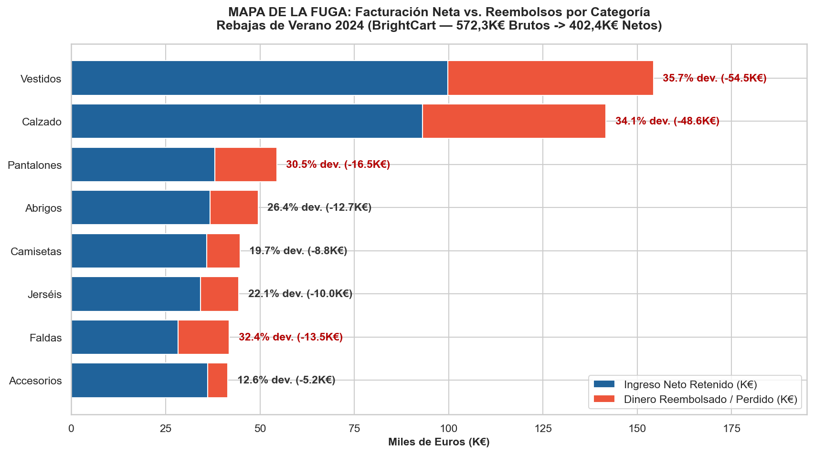
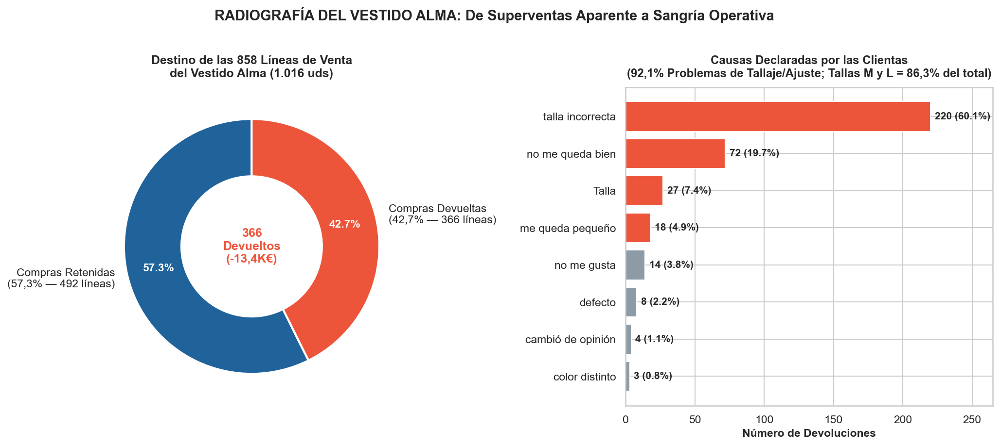
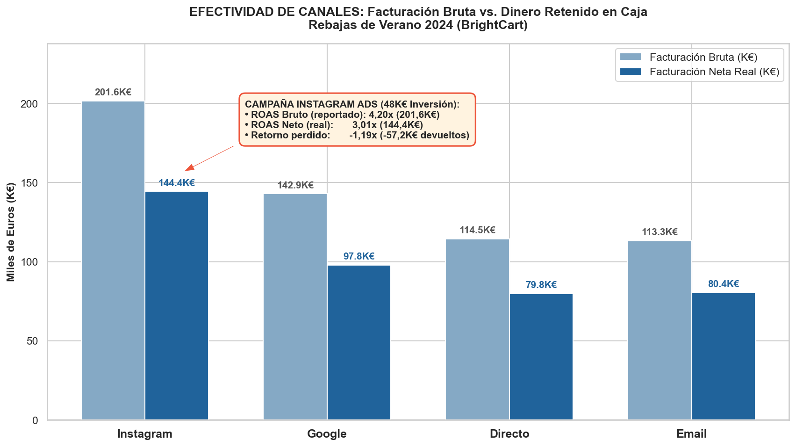
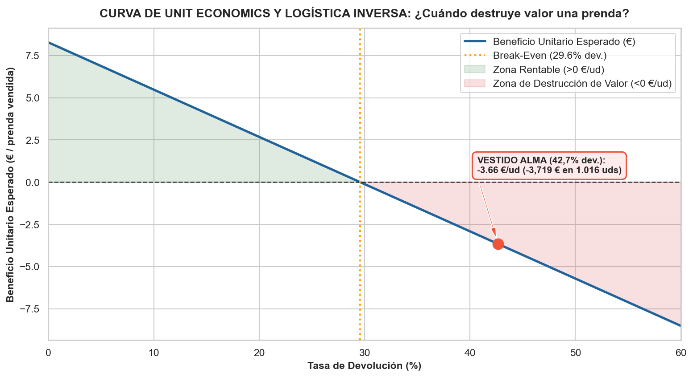

🇲🇽 [Versión en español](README.md)

# BrightCart — Retail / Fashion e-commerce

**Business question:** Was the Summer Sale 2024 really profitable once returns and reverse logistics are deducted? Should the *Vestido Alma* (Alma Dress) be restocked?

## Business context

Online fashion store closing its Summer Sale 2024 campaign with record gross revenue and needing to decide whether to restock its best-selling item.

5-day case study ("real assignment" format): exploration, cleaning, SQL/Python analysis, discovery of the key insight, stress-testing against alternative hypotheses, and executive communication.

## Dataset

Synthetic case data in `data/` (18 CSV files; folders: `data/`, `data/clean/`, `data/raw/`). `raw/` holds the original data and `clean/` the cleaned tables produced by the notebooks.

## Method (day by day)

| Notebook | Content |
|---|---|
| [`dia_01.ipynb`](dia_01.ipynb) | Day 1 — Your first assignment and the data |
| [`dia_02.ipynb`](dia_02.ipynb) | Day 2 — The analyst's *mise en place* and Diego's question: "Gross or net?" |
| [`dia_03.ipynb`](dia_03.ipynb) | Day 3 — From "how much" to "what": Categories, Star Item and Conversion by Channel |
| [`dia_04.ipynb`](dia_04.ipynb) | Day 4 — From Gross Revenue to Real Net Margin |
| [`dia_05.ipynb`](dia_05.ipynb) | Day 5 — The Demo, Unit Economics Stress-Test and Executive Close |

## Key findings

Faithful English translation of the opening section of the executive one-pager ([`reports/ONE_PAGER.md`](reports/ONE_PAGER.md), in Spanish); all figures come from the notebooks:

> ## 1. Executive Summary (In one sentence)
> The **Summer Sale 2024 (`campana_id = 1`)** campaign looks like a resounding success on the sales dashboards because it took in **$572.301,82\text{ €}$ in cash** ($+11,70\%$ versus $512.340,00\text{ €}$ the previous year, on $748.731,02\text{ €}$ at catalog price with an average discount of $23,56\%$), driven by **Instagram Ads** ($\text{ROAS Bruto } 4,20\times$) and the best-selling **Vestido Alma** ($1.016$ units and $30.473,90\text{ €}$ gross); however, crossing with returns and operating costs reveals that **$27,68\%$ of sold lines came back to the warehouse** ($4.718$ of $17.044$ lines; $5.535$ of $20.008$ garments), draining **$-169.918,32\text{ €}$ in refunds** ($29,69\%$ of cash) plus **$-30.667,00\text{ €}$ in reverse logistics** ($6,50\text{ €/devolución}$), leaving **Real Net Revenue at $402.383,51\text{ €}$** ($371.716,51\text{ €}$ after logistics). The **Vestido Alma** is the epicenter of the bleeding, with a **$42,66\%$ return rate** ($92,08\%$ due to poor pattern-making in sizes **M** and **L**) and a **negative unit margin of $-3,66\text{ €/prenda}$** (losing **$-3.719,34\text{ €}$ net**), so **the restocking order of $2.000$ units must be cancelled immediately** (avoiding **$31.132,59\text{ €}$** in direct losses).

Structure of the documented findings:

- 1. Executive Summary (In one sentence)
- 2. The Three Key Findings
- Finding 1 — On the surface Nuria is right: the campaign set a record in volume and gross cash revenue
- Finding 2 — When crossed with returns, `Vestidos` (Dresses) and `Calzado` (Footwear) account for $60,71\%$ of all money leakage
- Finding 3 — The illusion of Gross ROAS in Marketing and the cross-channel conversion paradox
- 3. Master Tables of the Summer Sale 2024 Campaign (`campana_id = 1`)
- 4. Stress-Testing the Finding: Forensic X-Ray of the "Vestido Alma" and Unit Economics
- 5. Actionable Recommendation for the Committee (Quantified Impact: $+51.637,16\text{ €}$)
- 6. Supporting Charts in `reports/`

## Charts









## Tools

Python 3, Pandas, NumPy, Matplotlib, Seaborn, Jupyter Notebook.

## How to run

```bash
pip install -r ../requirements.txt
cd brightcart
jupyter notebook
```

Run the notebooks in order (`dia_01` → `dia_05`); paths are relative to this folder. The notebooks already include their outputs, so they can be read directly on GitHub. (Notebooks are in Spanish.)

> Note: course briefs and materials (assignment statements, syllabi and PDF dumps) were excluded from the repository because they may be copyrighted content. The notebooks run without them.
