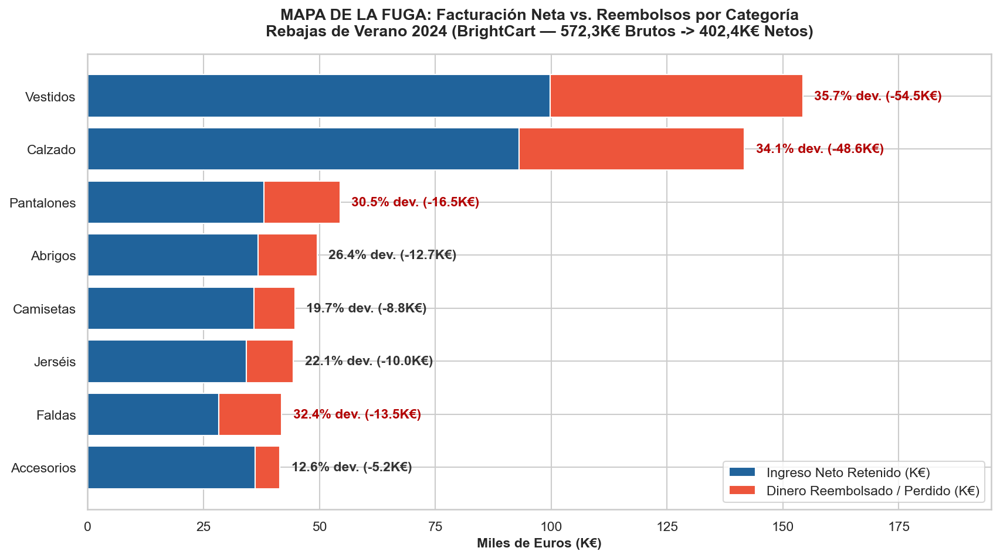
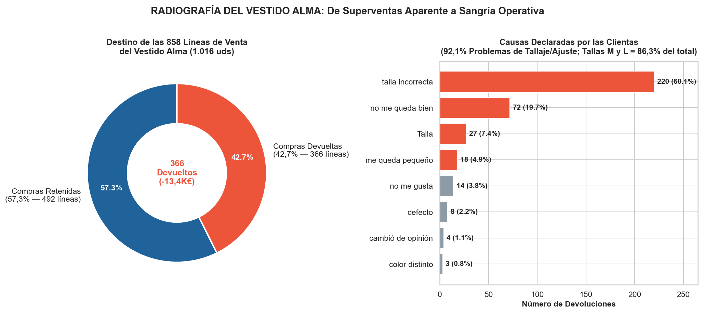
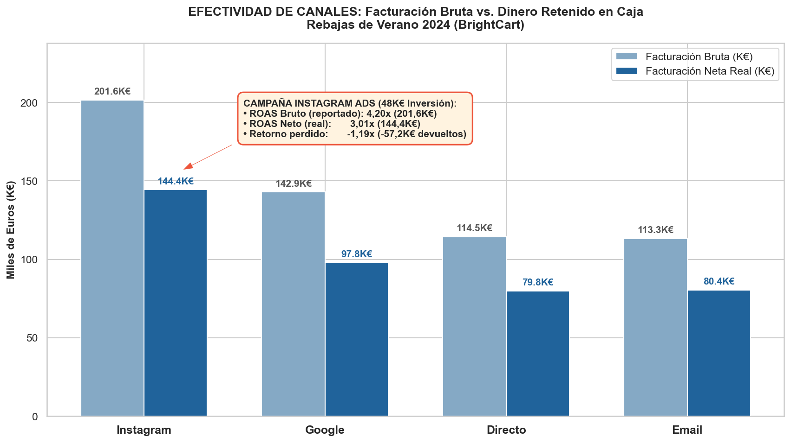
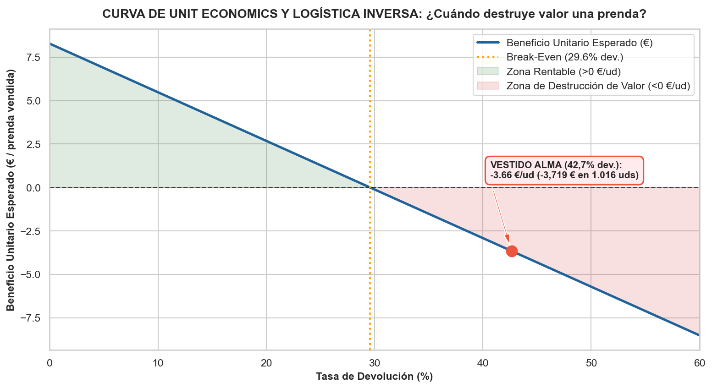

🇬🇧 [English version](README.en.md)

# BrightCart — Retail / E-commerce de moda

**Pregunta de negocio:** ¿Fueron realmente rentables las Rebajas de Verano 2024 una vez descontadas devoluciones y logística inversa? ¿Conviene reponer el *Vestido Alma*?

## Contexto de negocio

Tienda de moda online que cierra su campaña de Rebajas de Verano 2024 con récord de facturación bruta y quiere decidir la reposición de su prenda estrella.

Caso de estudio de 5 días (formato «encargo real»): exploración, limpieza, análisis en SQL/Python, descubrimiento del hallazgo, blindaje frente a hipótesis alternativas y comunicación ejecutiva.

## Dataset

Datos sintéticos del caso en `data/` (18 ficheros CSV; carpetas: `data/`, `data/clean/`, `data/raw/`). `raw/` contiene los datos originales y `clean/` las tablas limpias generadas por los cuadernos.

## Método (día a día)

| Cuaderno | Contenido |
|---|---|
| [`dia_01.ipynb`](dia_01.ipynb) | Día 1 — Tu primer encargo y los datos |
| [`dia_02.ipynb`](dia_02.ipynb) | Día 2 — La *mise en place* del analista y la pregunta de Diego: «¿Bruto o neto?» |
| [`dia_03.ipynb`](dia_03.ipynb) | Día 3 — Del «cuánto» al «qué»: Categorías, Prenda Estrella y Conversión por Canal |
| [`dia_04.ipynb`](dia_04.ipynb) | Día 4 — De la Facturación Bruta al Margen Neto Real |
| [`dia_05.ipynb`](dia_05.ipynb) | Día 5 — La Demo, el Blindaje de Unit Economics y el Cierre Ejecutivo |

## Hallazgos clave

Extracto literal del one-pager ejecutivo ([`reports/ONE_PAGER.md`](reports/ONE_PAGER.md)); todas las cifras provienen de los cuadernos:

> ## 1. Resumen Ejecutivo (En una frase)
> La campaña de **Rebajas de Verano 2024 (`campana_id = 1`)** parece un éxito rotundo en los paneles comerciales porque facturó **$572.301,82\text{ €}$ en caja** ($+11,70\%$ frente a los $512.340,00\text{ €}$ del año anterior, sobre $748.731,02\text{ €}$ a precio de catálogo con un $23,56\%$ de descuento medio), impulsada por **Instagram Ads** ($\text{ROAS Bruto } 4,20\times$) y el superventas **Vestido Alma** ($1.016$ unidades y $30.473,90\text{ €}$ brutos); sin embargo, al cruzar con devoluciones y costes operativos se destapa que el **$27,68\%$ de las líneas vendidas regresó al almacén** ($4.718$ de $17.044$ líneas; $5.535$ de $20.008$ prendas), drenando **$-169.918,32\text{ €}$ en reembolsos** ($29,69\%$ de la caja) más **$-30.667,00\text{ €}$ en logística inversa** ($6,50\text{ €/devolución}$) para dejar el **Ingreso Neto Real en $402.383,51\text{ €}$** ($371.716,51\text{ €}$ post-logística), siendo el **Vestido Alma** el epicentro de la sangría con un **$42,66\%$ de devolución** ($92,08\%$ por mal patronaje en las tallas **M** y **L**) y un **margen unitario negativo de $-3,66\text{ €/prenda}$** (perdiendo **$-3.719,34\text{ €}$ netos**), por lo que **debe cancelarse de inmediato la orden de reposición de $2.000$ unidades** (evitando **$31.132,59\text{ €}$** en pérdidas directas).

Estructura de los hallazgos documentados:

- 1. Resumen Ejecutivo (En una frase)
- 2. Los Tres Hallazgos Clave
- Hallazgo 1 — En la superficie Nuria tiene razón: la campaña batió récord de volumen y facturación bruta en caja
- Hallazgo 2 — Al cruzar con devoluciones, `Vestidos` y `Calzado` concentran el $60,71\%$ de toda la fuga de dinero
- Hallazgo 3 — La ilusión del ROAS Bruto en Marketing y la paradoja de conversión entre canales
- 3. Tablas Maestras de la Campaña Rebajas de Verano 2024 (`campana_id = 1`)
- 4. Blindaje del Hallazgo: Radiografía Forense del «Vestido Alma» y Unit Economics
- 5. Recomendación Accionable para el Comité (Impacto Cuantificado: $+51.637,16\text{ €}$)
- 6. Gráficos de Soporte en `reports/`

## Gráficos









## Herramientas

Python 3, Pandas, NumPy, Matplotlib, Seaborn, Jupyter Notebook.

## Cómo ejecutar

```bash
pip install -r ../requirements.txt
cd brightcart
jupyter notebook
```

Ejecuta los cuadernos en orden (`dia_01` → `dia_05`); las rutas son relativas a esta carpeta. Los cuadernos ya incluyen sus salidas, por lo que se pueden leer directamente en GitHub.

> Nota: se excluyeron del repositorio los briefs y materiales del curso (enunciados, temarios y volcados de PDF), ya que pueden ser contenido con derechos de autor. Los cuadernos funcionan sin ellos.
