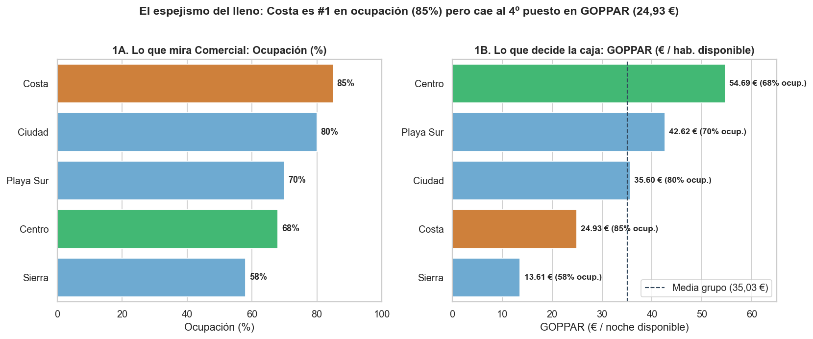
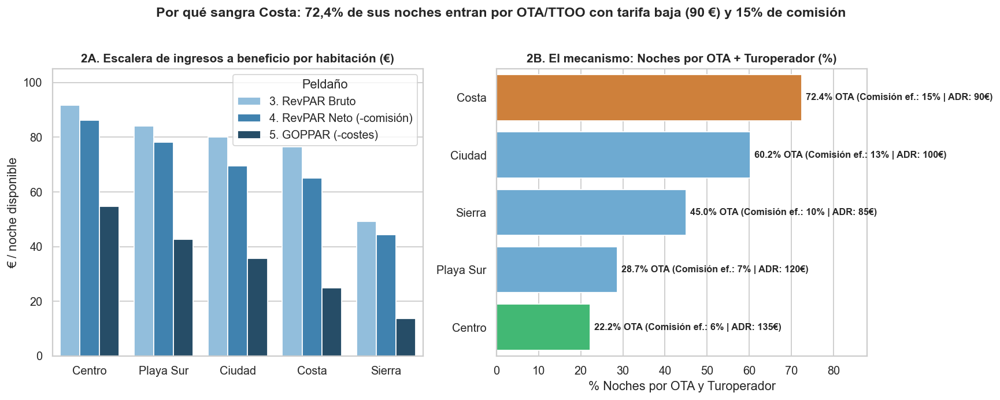
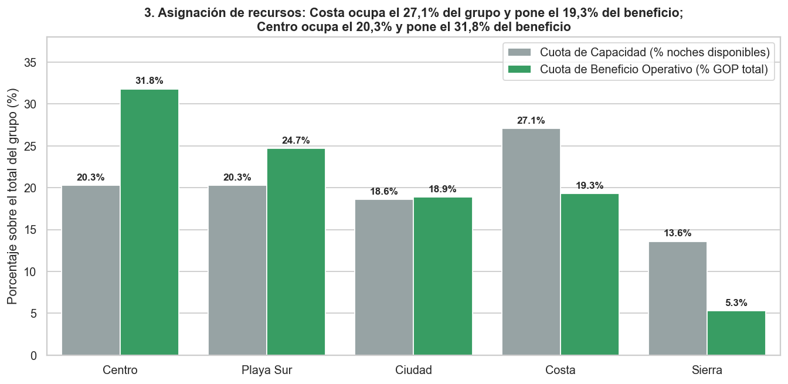
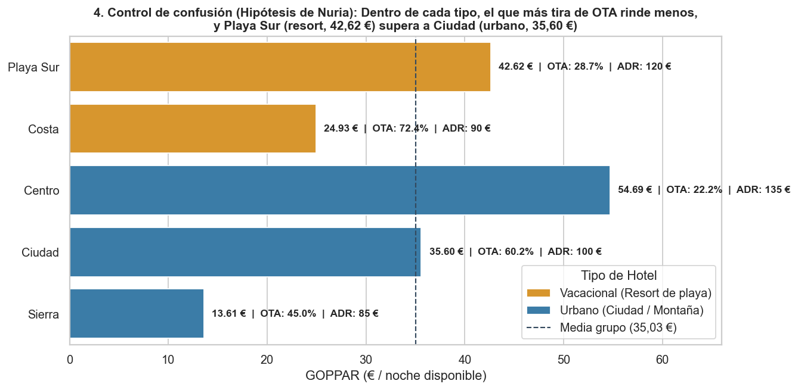

🇲🇽 [Versión en español](README.md)

# El Mirador — Hospitality

**Business question:** Is a full hotel a profitable hotel? Where should the group invest its annual budget?

## Business context

Hotel group with five properties (city and resort) deciding where to invest based on profitability per available room.

5-day case study ("real assignment" format): exploration, cleaning, SQL/Python analysis, discovery of the key insight, stress-testing against alternative hypotheses, and executive communication.

## Dataset

Synthetic case data in `data/` (12 CSV files; folders: `data/clean/`, `data/raw/`). `raw/` holds the original data and `clean/` the cleaned tables produced by the notebooks.

## Method (day by day)

| Notebook | Content |
|---|---|
| [`dia_01.ipynb`](dia_01.ipynb) | Day 1 — First contact with the data |
| [`dia_02.ipynb`](dia_02.ipynb) | Day 2 — Clean before calculating anything |
| [`dia_03.ipynb`](dia_03.ipynb) | Day 3 (Morning and Afternoon) — From the Surface Ranking to the First Crack: RevPAR, Channel and Commission |
| [`dia_04.ipynb`](dia_04.ipynb) | Day 4 — The discovery: net RevPAR and GOPPAR |
| [`dia_05.ipynb`](dia_05.ipynb) | Day 5 — Stress-test the finding and make it change something |

## Key findings

Faithful English translation of the opening section of the executive one-pager ([`reports/ONE_PAGER.md`](reports/ONE_PAGER.md), in Spanish); all figures come from the notebooks:

> ## 1. Executive Summary (In one sentence)
> **El Mirador Costa** looks like the undisputed star on the Sales dashboards because it leads in **occupancy ($85,0\%$)**, **room nights sold ($68.000$)** and **gross room revenue ($6,12\text{ M€}$)**, but it achieves that full house by **buying volume through OTAs and tour operators ($72,4\%$ of its nights)** at the **lowest average rate among the large hotels ($\text{ADR } 90,00\text{ €}$)** and with the **highest effective commission in the group ($15,0\%$)**; after deducting commissions and operating costs, Costa drops to **second-to-last in profit per available room ($\text{GOPPAR } 24,93\text{ €}$)** —using **$27,1\%$ of the group's capacity** to deliver only **$19,3\%$ of profit**—, while **El Mirador Centro**, with $68,0\%$ occupancy but selling at a high rate ($\text{ADR } 135,00\text{ €}$) through direct/corporate channels ($77,8\%$ of its nights, $6,0\%$ commission), generates **more than double the profit per room ($\text{GOPPAR } 54,69\text{ €}$)** and contributes **$31,8\%$ of group profit** with only **$20,3\%$ of capacity**.

Structure of the documented findings:

- 1. Executive Summary (In one sentence)
- 2. The Metrics Ladder: Where the Mirage Breaks
- 3. Master Table of the Metrics Ladder by Hotel (Fiscal Year 2024)
- 4. Stress-Testing the Finding: Alternative Hypotheses Ruled Out
- 5. Four-Lever Recommendation for Elena Miralles
- 6. Executive Charts in `reports/`

## Charts









## Tools

Python 3, Pandas, NumPy, DuckDB (SQL), Matplotlib, Seaborn, Jupyter Notebook.

## How to run

```bash
pip install -r ../requirements.txt
cd elmirador
jupyter notebook
```

Run the notebooks in order (`dia_01` → `dia_05`); paths are relative to this folder. The notebooks already include their outputs, so they can be read directly on GitHub. (Notebooks are in Spanish.)
