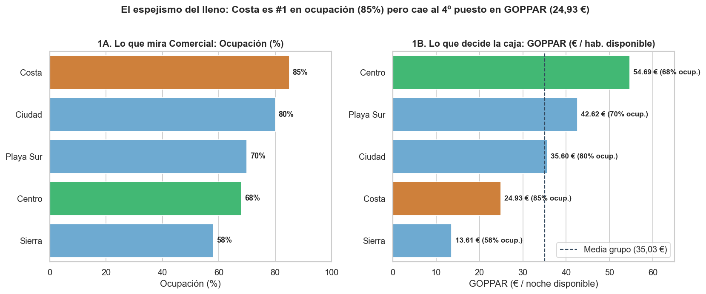
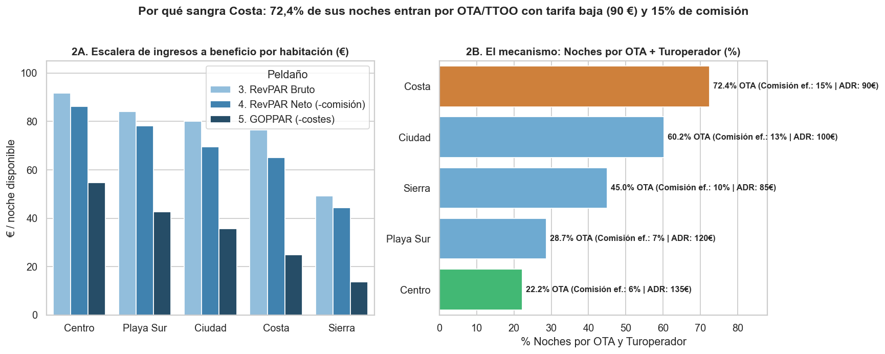
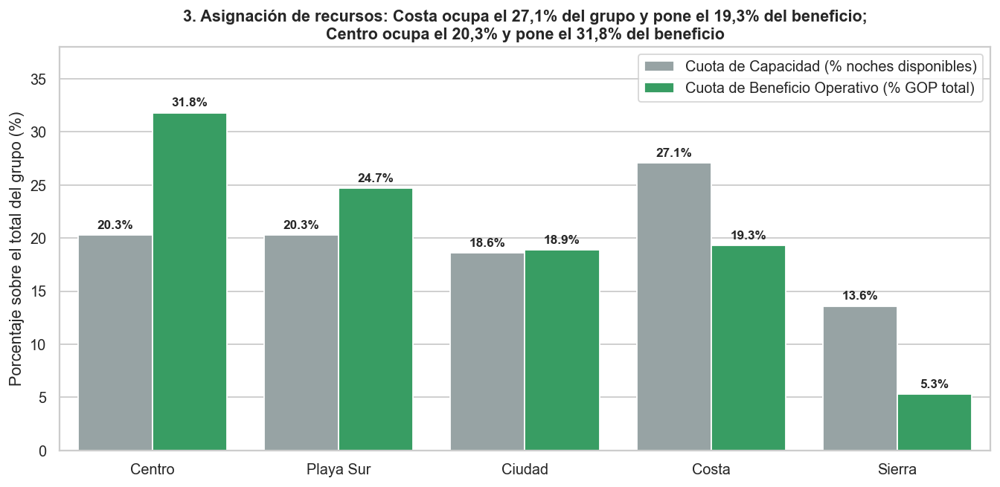
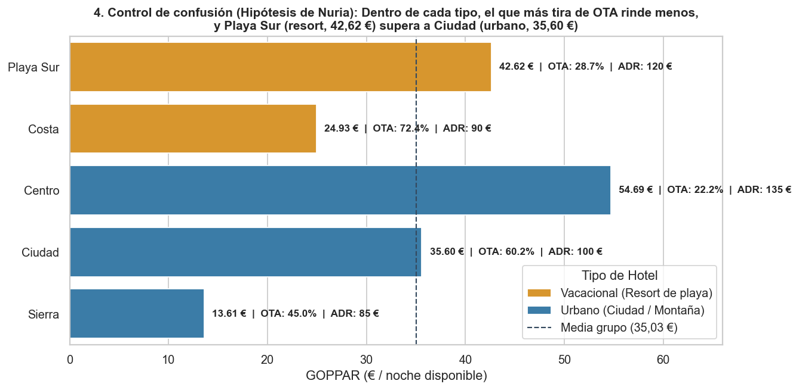

🇬🇧 [English version](README.en.md)

# El Mirador — Hotelería

**Pregunta de negocio:** ¿Un hotel lleno es un hotel rentable? ¿Dónde invertir el presupuesto anual del grupo?

## Contexto de negocio

Grupo hotelero con cinco hoteles (urbanos y vacacionales) que decide dónde invertir según su rentabilidad por habitación disponible.

Caso de estudio de 5 días (formato «encargo real»): exploración, limpieza, análisis en SQL/Python, descubrimiento del hallazgo, blindaje frente a hipótesis alternativas y comunicación ejecutiva.

## Dataset

Datos sintéticos del caso en `data/` (12 ficheros CSV; carpetas: `data/clean/`, `data/raw/`). `raw/` contiene los datos originales y `clean/` las tablas limpias generadas por los cuadernos.

## Método (día a día)

| Cuaderno | Contenido |
|---|---|
| [`dia_01.ipynb`](dia_01.ipynb) | Día 1 — Primer contacto con los datos |
| [`dia_02.ipynb`](dia_02.ipynb) | Día 2 — Limpiar, antes de calcular nada |
| [`dia_03.ipynb`](dia_03.ipynb) | Día 3 (Mañana y Tarde) — Del Ranking de Superficie a la Primera Grieta: RevPAR, Canal y Comisión |
| [`dia_04.ipynb`](dia_04.ipynb) | Día 4 — El descubrimiento: RevPAR neto y GOPPAR |
| [`dia_05.ipynb`](dia_05.ipynb) | Día 5 — Blindar el hallazgo y que cambie algo |

## Hallazgos clave

Extracto literal del one-pager ejecutivo ([`reports/ONE_PAGER.md`](reports/ONE_PAGER.md)); todas las cifras provienen de los cuadernos:

> ## 1. Resumen Ejecutivo (En una frase)
> **El Mirador Costa** parece la estrella indiscutible en los cuadros de mando de Comercial porque lidera en **ocupación ($85,0\%$)**, en **noches vendidas ($68.000$)** y en **facturación bruta de habitación ($6,12\text{ M€}$)**, pero logra ese lleno **comprando volumen a través de OTA y turoperadores ($72,4\%$ de sus noches)** con la **tarifa media más baja de los hoteles grandes ($\text{ADR } 90,00\text{ €}$)** y la **comisión efectiva más alta del grupo ($15,0\%$)**; al descontar comisiones y costes operativos, Costa cae al **penúltimo puesto en beneficio por habitación disponible ($\text{GOPPAR } 24,93\text{ €}$)** —consumiendo el **$27,1\%$ de la capacidad del grupo** para aportar solo el **$19,3\%$ del beneficio**—, mientras que **El Mirador Centro**, con un $68,0\%$ de ocupación pero vendiendo caro ($\text{ADR } 135,00\text{ €}$) y por canal directo/corporate ($77,8\%$ de sus noches, comisión del $6,0\%$), genera **más del doble de beneficio por habitación ($\text{GOPPAR } 54,69\text{ €}$)** y aporta el **$31,8\%$ del beneficio del grupo** con solo el **$20,3\%$ de la capacidad**.

Estructura de los hallazgos documentados:

- 1. Resumen Ejecutivo (En una frase)
- 2. La Escalera de Métricas: Dónde se Rompe el Espejismo
- 3. Tabla Maestra de la Escalera de Métricas por Hotel (Ejercicio 2024)
- 4. Blindaje del Hallazgo: Hipótesis Alternativas Descartadas
- 5. Recomendación en Cuatro Palancas para Elena Miralles
- 6. Gráficos Ejecutivos en `reports/`

## Gráficos









## Herramientas

Python 3, Pandas, NumPy, DuckDB (SQL), Matplotlib, Seaborn, Jupyter Notebook.

## Cómo ejecutar

```bash
pip install -r ../requirements.txt
cd elmirador
jupyter notebook
```

Ejecuta los cuadernos en orden (`dia_01` → `dia_05`); las rutas son relativas a esta carpeta. Los cuadernos ya incluyen sus salidas, por lo que se pueden leer directamente en GitHub.
