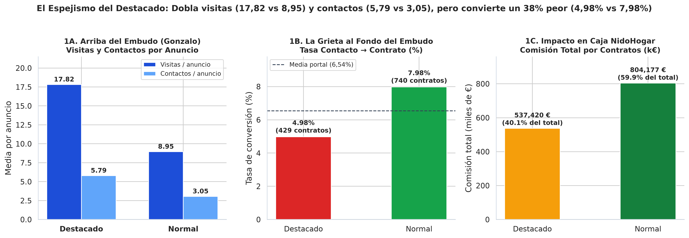
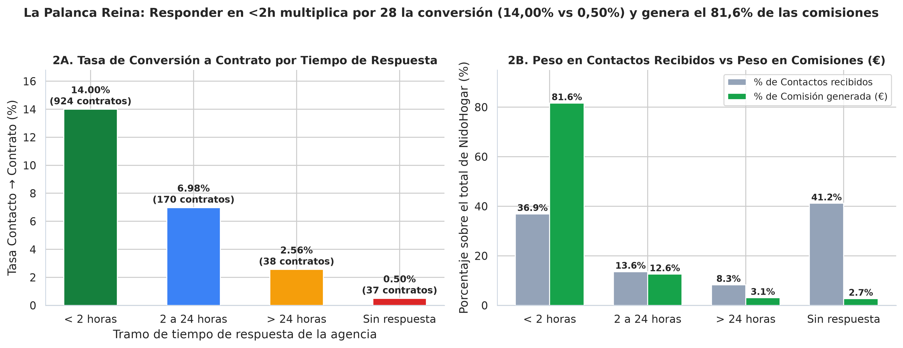
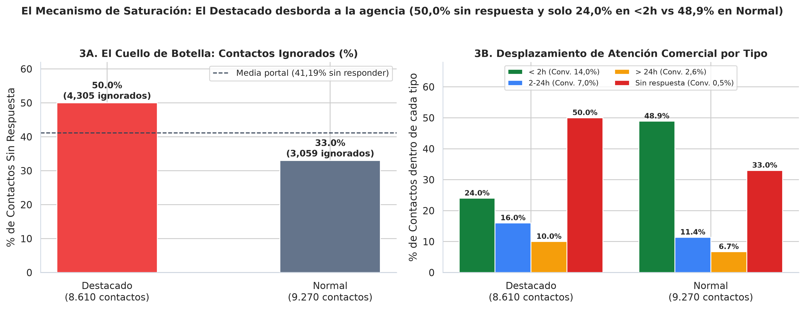
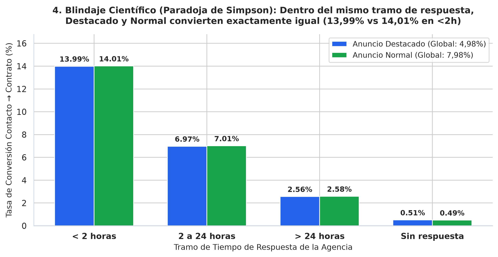

🇲🇽 [Versión en español](README.md)

# NidoHogar — Real-estate portal (proptech)

**Business question:** Does the "Destacado Premium" (Featured Premium) product turn more visits into signed contracts, or does it only generate more traffic?

## Business context

Real-estate portal that sells visibility ("Destacado"/Featured listings) to agencies and needs to audit the full funnel from click to contract.

5-day case study ("real assignment" format): exploration, cleaning, SQL/Python analysis, discovery of the key insight, stress-testing against alternative hypotheses, and executive communication.

## Dataset

Synthetic case data in `data/` (14 CSV files; folders: `data/clean/`, `data/raw/`). `raw/` holds the original data and `clean/` the cleaned tables produced by the notebooks.

## Method (day by day)

| Notebook | Content |
|---|---|
| [`dia_01.ipynb`](dia_01.ipynb) | Day 1 — Initial Exploration and Forensic Data Audit (EDA) |
| [`dia_02.ipynb`](dia_02.ipynb) | Day 2 — Systematic Cleaning (`data/clean/`) and the Full Funnel in SQL |
| [`dia_03.ipynb`](dia_03.ipynb) | Day 3 — The First Crack: Featured Listings Convert 38 % Worse to Contract |
| [`dia_04.ipynb`](dia_04.ipynb) | Day 4 — Are They Rented, or Just Viewed? The Causal Mechanism and the Stress-Test |
| [`dia_05.ipynb`](dia_05.ipynb) | Day 5 — Make It Understood and Make It Change Something: The 4 Executive Charts and the One-Pager |

## Key findings

Faithful English translation of the opening section of the executive one-pager ([`reports/ONE_PAGER.md`](reports/ONE_PAGER.md), in Spanish); all figures come from the notebooks:

> ## 1. Executive Summary (In one sentence)
> **Featured** listings look like the star product on the Sales dashboards because, with **$31,68\%$ of the catalog** ($1.489$ of $4.700$ properties), they **almost double visits per property ($17,82$ vs $8,95$, $\times 1,99$) and contacts received ($5,79$ vs $3,05$, $\times 1,90$)**, but by flooding agencies that lack response capacity with messages, **$50,00\%$ of their contacts go unanswered ($4.305$ of $8.610$ leads ignored)** versus **$33,00\%$ for normal listings ($3.059$ of $9.270$)**, sinking their **contract conversion rate by $-37,6\%$ ($4,98\%$ vs $7,98\%$)** and their cash contribution (**$537.419,74\text{ €}$ in commissions [$40,06\%$]** versus **$804.176,79\text{ €}$ [$59,94\%$]** for normal listings); given that **responding in under $2$ hours multiplies the probability of signing by $28$ ($14,00\%$ vs $0,50\%$)** and that **within the same `<2h` bracket featured and normal listings convert exactly the same ($13,99\%$ vs $14,01\%$)**, launching *"Destacado Premium"* without first fixing the sales bottleneck would only multiply ignored leads rather than contracts (**leaving $+258$ contracts and $+337.358\text{ €}$ per year in commissions on the table**).

Structure of the documented findings:

- 1. Executive Summary (In one sentence)
- 2. The Three Key Findings
- Finding 1 — Gonzalo is right on the surface: Featured wins at the top of the funnel in traffic and contacts
- Finding 2 — When crossed with contracts and response times, the ranking flips due to Sales Saturation
- Finding 3 — The number that decides the budget: $804.177\text{ €}$ vs $537.420\text{ €}$ in commissions and $+337.358\text{ €}$ left on the table
- 3. Master Funnel Tables (Clean Base: 4.700 Listings · 55.275 Visits · 17.880 Contacts · 1.169 Contracts)
- 4. Stress-Testing the Finding: Alternative Hypotheses Ruled Out
- 5. Actionable Recommendation for the Committee
- 6. Supporting Charts in `reports/`

## Charts









## Tools

Python 3, Pandas, NumPy, DuckDB (SQL), Matplotlib, Seaborn, Jupyter Notebook.

## How to run

```bash
pip install -r ../requirements.txt
cd nidohogar
jupyter notebook
```

Run the notebooks in order (`dia_01` → `dia_05`); paths are relative to this folder. The notebooks already include their outputs, so they can be read directly on GitHub. (Notebooks are in Spanish.)
