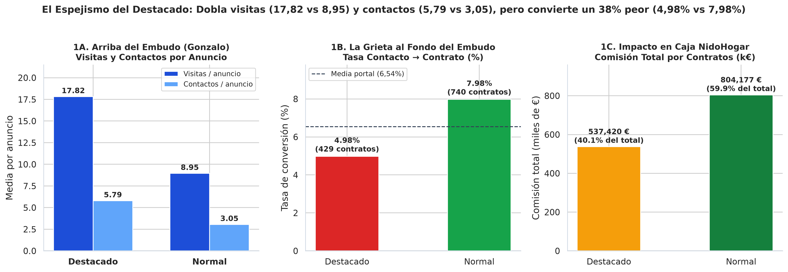
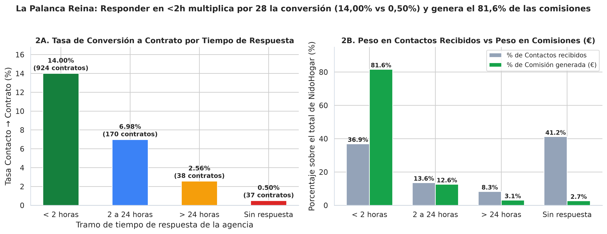
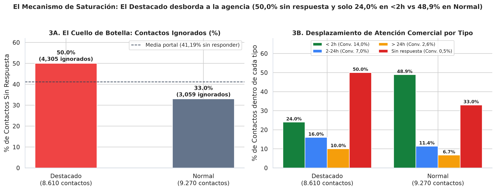
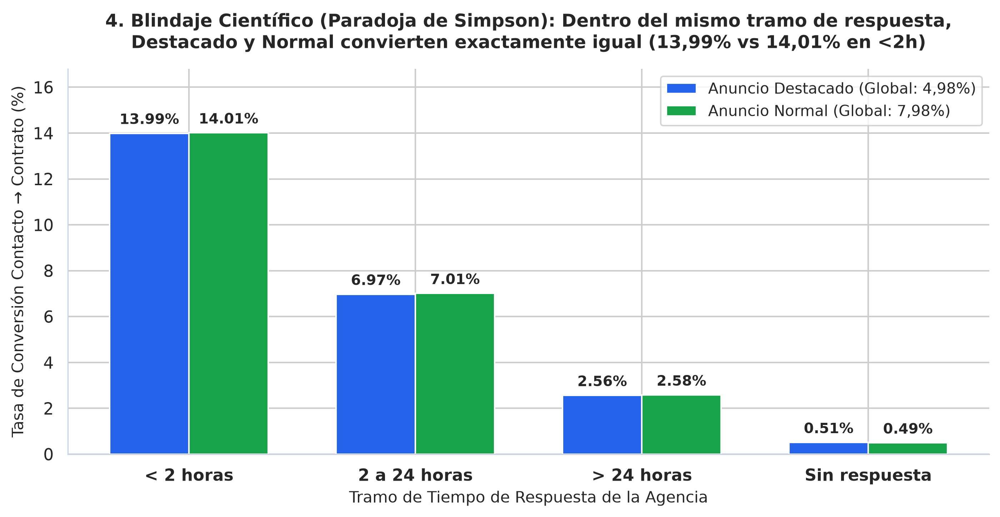

🇬🇧 [English version](README.en.md)

# NidoHogar — Portal inmobiliario (proptech)

**Pregunta de negocio:** ¿El producto «Destacado Premium» convierte más visitas en contratos firmados, o solo genera más tráfico?

## Contexto de negocio

Portal inmobiliario que vende visibilidad («Destacado») a agencias y necesita auditar el embudo completo del clic al contrato.

Caso de estudio de 5 días (formato «encargo real»): exploración, limpieza, análisis en SQL/Python, descubrimiento del hallazgo, blindaje frente a hipótesis alternativas y comunicación ejecutiva.

## Dataset

Datos sintéticos del caso en `data/` (14 ficheros CSV; carpetas: `data/clean/`, `data/raw/`). `raw/` contiene los datos originales y `clean/` las tablas limpias generadas por los cuadernos.

## Método (día a día)

| Cuaderno | Contenido |
|---|---|
| [`dia_01.ipynb`](dia_01.ipynb) | Día 1 — Exploración Inicial y Auditoría Forense de Datos (EDA) |
| [`dia_02.ipynb`](dia_02.ipynb) | Día 2 — Limpieza Sistemática (`data/clean/`) y El Embudo Completo en SQL |
| [`dia_03.ipynb`](dia_03.ipynb) | Día 3 — La Primera Grieta: El Destacado Convierte un 38 % Peor a Contrato |
| [`dia_04.ipynb`](dia_04.ipynb) | Día 4 — ¿Se Alquilan, o Solo se Miran? El Mecanismo Causal y el Blindaje |
| [`dia_05.ipynb`](dia_05.ipynb) | Día 5 — Que se Entienda y Cambie Algo: Los 4 Gráficos Ejecutivos y el One-Pager |

## Hallazgos clave

Extracto literal del one-pager ejecutivo ([`reports/ONE_PAGER.md`](reports/ONE_PAGER.md)); todas las cifras provienen de los cuadernos:

> ## 1. Resumen Ejecutivo (En una frase)
> Los anuncios **destacados** parecen el producto estrella en los cuadros de mando de Comercial porque, con el **$31,68\%$ del catálogo** ($1.489$ de $4.700$ pisos), **casi duplican las visitas por inmueble ($17,82$ vs $8,95$, $\times 1,99$) y los contactos recibidos ($5,79$ vs $3,05$, $\times 1,90$)**, pero al inundar de mensajes a agencias sin capacidad de atención provocan que el **$50,00\%$ de sus contactos queden sin respuesta ($4.305$ de $8.610$ leads ignorados)** frente al **$33,00\%$ en anuncios normales ($3.059$ de $9.270$)**, hundiendo su **tasa de conversión a contrato un $-37,6\%$ ($4,98\%$ vs $7,98\%$)** y su aportación a caja (**$537.419,74\text{ €}$ en comisiones [$40,06\%$]** frente a **$804.176,79\text{ €}$ [$59,94\%$]** de los normales); dado que **responder en menos de $2$ horas multiplica por $28$ la probabilidad de firma ($14,00\%$ vs $0,50\%$)** y que **dentro del mismo tramo `<2h` destacado y normal convierten exactamente igual ($13,99\%$ vs $14,01\%$)**, lanzar *«Destacado Premium»* sin corregir antes el cuello de botella comercial solo multiplicaría los leads ignorados en lugar de los contratos (**dejando sobre la mesa $+258$ contratos y $+337.358\text{ €}$ anuales en comisiones**).

Estructura de los hallazgos documentados:

- 1. Resumen Ejecutivo (En una frase)
- 2. Los Tres Hallazgos Clave
- Hallazgo 1 — Gonzalo tiene razón en la superficie: el Destacado gana arriba del embudo en tráfico y contactos
- Hallazgo 2 — Al cruzar con contratos y tiempos de respuesta, el ranking se invierte por Saturación Comercial
- Hallazgo 3 — El número que decide el presupuesto: $804.177\text{ €}$ vs $537.420\text{ €}$ en comisiones y $+337.358\text{ €}$ sobre la mesa
- 3. Tablas Maestras del Embudo (Base Limpia: 4.700 Anuncios · 55.275 Visitas · 17.880 Contactos · 1.169 Contratos)
- 4. Blindaje del Hallazgo: Hipótesis Alternativas Descartadas
- 5. Recomendación Accionable para el Comité
- 6. Gráficos de Soporte en `reports/`

## Gráficos









## Herramientas

Python 3, Pandas, NumPy, DuckDB (SQL), Matplotlib, Seaborn, Jupyter Notebook.

## Cómo ejecutar

```bash
pip install -r ../requirements.txt
cd nidohogar
jupyter notebook
```

Ejecuta los cuadernos en orden (`dia_01` → `dia_05`); las rutas son relativas a esta carpeta. Los cuadernos ya incluyen sus salidas, por lo que se pueden leer directamente en GitHub.
