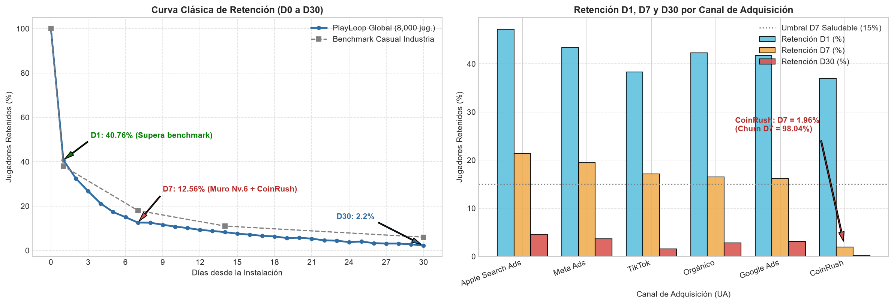
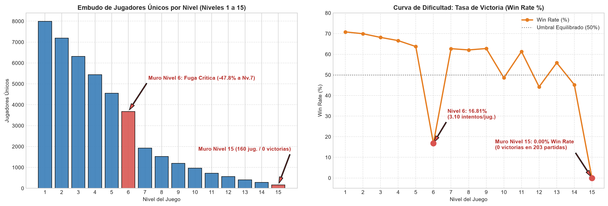
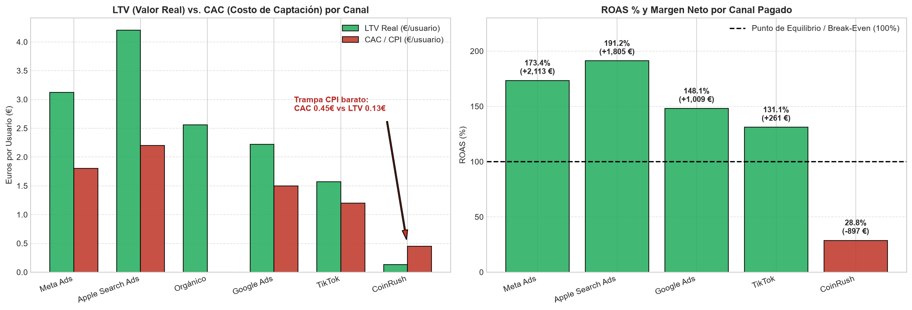
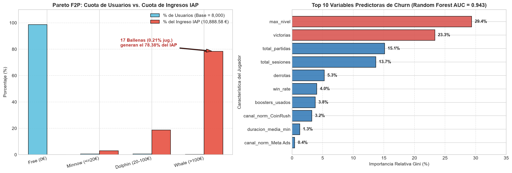

🇲🇽 [Versión en español](README.md)

# PlayLoop — Mobile gaming (F2P)

**Business question:** Which acquisition channels bring players who stay and monetize, where does the level funnel break, and who is about to churn?

## Business context

Free-to-play mobile game studio with hybrid monetization (in-app purchases + ads) evaluating its User Acquisition spend.

5-day case study ("real assignment" format): exploration, cleaning, SQL/Python analysis, discovery of the key insight, stress-testing against alternative hypotheses, and executive communication.

## Dataset

Synthetic case data in `data/` (22 CSV files; folders: `data/clean/`, `data/raw/`). `raw/` holds the original data and `clean/` the cleaned tables produced by the notebooks.

## Method (day by day)

| Notebook | Content |
|---|---|
| [`dia_01.ipynb`](dia_01.ipynb) | 📅 Day 1: Ingestion, Forensic Audit and Data Model (Star Schema) |
| [`dia_02.ipynb`](dia_02.ipynb) | 📅 Day 2: Engagement, Activity and Level Funnel (Gameplay Funnel) |
| [`dia_03.ipynb`](dia_03.ipynb) | 📅 Day 3: Retention Cohorts (D1, D7, D14, D30) and Quality by Acquisition Channel |
| [`dia_04.ipynb`](dia_04.ipynb) | 📅 Day 4: Hybrid Monetization (IAP + Ads), ARPU / ARPPU and Whale Segmentation |
| [`dia_05.ipynb`](dia_05.ipynb) | 📅 Day 5: Machine Learning for Churn Prediction and Preventive Strategy |

## Key findings

Faithful English translation of the opening section of the executive one-pager ([`reports/ONE_PAGER.md`](reports/ONE_PAGER.md), in Spanish); all figures come from the notebooks:

> ## 1. Executive Summary (In one sentence)
> **`CoinRush`** appears to be the growth engine on the surface-level User Acquisition dashboards because it brings **$35,0\%$ of all installs** ($2.800$ of $8.000$ players) at the **lowest CPI/CAC on the market ($0,45\text{ €}$)**, but being incentivized traffic it suffers a **Day-7 Churn of $98,04\%$** ($\text{Retención D7 } 1,96\%$, $\text{D30 } 0,14\%$) and generates a **tiny LTV of $0,13\text{ €}$**, becoming the **only channel with a loss-making ROAS ($28,79\%$) and destroying $-897,26\text{ €}$ of net margin** (without it, PlayLoop's net profit would rise from **$+5.826,56\text{ €}$** to **$+6.723,82\text{ €}$** with a ROAS of **$186,20\%$**); at the same time, in-game retention and revenue (**$14.886,57\text{ €}$ in total**, where **only $17$ Whales [$0,21\%$] contribute $78,38\%$ of IAP purchases**) are threatened by two critical design flaws confirmed by Machine Learning ($\text{Random Forest ROC-AUC } 0,9429$): the **Level 6 Frustration Wall** (where the Win Rate drops from **$63,74\%$ to $16,81\%$**, pushing out **$47,83\%$** of players) and the **Level 15 Technical Block** (**$0,00\%$ Win Rate** in $203$ matches).

Structure of the documented findings:

- 1. Executive Summary (In one sentence)
- 2. The Three Key Findings
- Finding 1 — The Cheap-CPI Trap in User Acquisition (`CoinRush` vs. `Apple Search Ads` and `Meta Ads`)
- Finding 2 — The Level Funnel (Gameplay Funnel): The Level 6 Wall and the Level 15 Technical Ceiling
- Finding 3 — Hybrid F2P Economy and Extreme Concentration in Whales (Pareto Law)
- 3. Master Results Tables (8.000 Unique Players Audited)
- 3.1 Master Table of Acquisition Channels (UA), Retention and Profitability (ROAS)
- 3.2 Master Table of F2P Segmentation (Pareto Law and Hybrid Revenue)
- 3.3 Level Funnel Milestones Summary (Gameplay Funnel: Levels 1 to 15)
- 4. Stress-Testing the Finding: The Level 15 Wall, Temporal Causality and Predictive Churn Model
- 5. Actionable Recommendation for the Committee
- 6. Supporting Charts in `reports/`

## Charts









## Tools

Python 3, Pandas, NumPy, Matplotlib, Seaborn, scikit-learn, Jupyter Notebook.

## How to run

```bash
pip install -r ../requirements.txt
cd playloop
jupyter notebook
```

Run the notebooks in order (`dia_01` → `dia_05`); paths are relative to this folder. The notebooks already include their outputs, so they can be read directly on GitHub. (Notebooks are in Spanish.)
