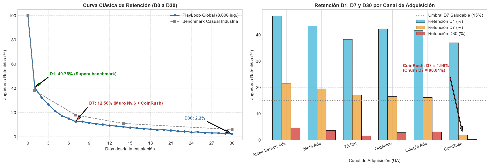
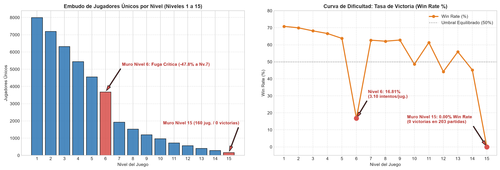
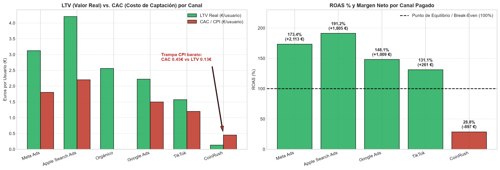
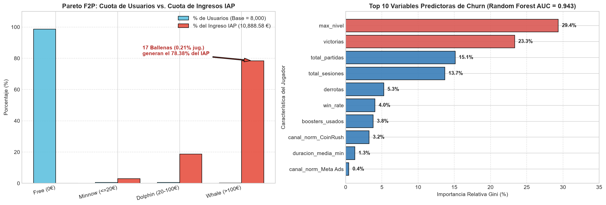

🇬🇧 [English version](README.en.md)

# PlayLoop — Videojuegos móviles (F2P)

**Pregunta de negocio:** ¿Qué canales de adquisición traen jugadores que se quedan y monetizan, dónde se rompe el embudo de niveles y quién va a abandonar?

## Contexto de negocio

Estudio de juegos móviles free-to-play con monetización híbrida (compras in-app + anuncios) que evalúa su inversión en User Acquisition.

Caso de estudio de 5 días (formato «encargo real»): exploración, limpieza, análisis en SQL/Python, descubrimiento del hallazgo, blindaje frente a hipótesis alternativas y comunicación ejecutiva.

## Dataset

Datos sintéticos del caso en `data/` (22 ficheros CSV; carpetas: `data/clean/`, `data/raw/`). `raw/` contiene los datos originales y `clean/` las tablas limpias generadas por los cuadernos.

## Método (día a día)

| Cuaderno | Contenido |
|---|---|
| [`dia_01.ipynb`](dia_01.ipynb) | 📅 Día 1: Ingesta, Auditoría Forense y Modelo de Datos (Star Schema) |
| [`dia_02.ipynb`](dia_02.ipynb) | 📅 Día 2: Engagement, Actividad y Embudo de Niveles (Gameplay Funnel) |
| [`dia_03.ipynb`](dia_03.ipynb) | 📅 Día 3: Cohortes de Retención (D1, D7, D14, D30) y Calidad por Canal de Adquisición |
| [`dia_04.ipynb`](dia_04.ipynb) | 📅 Día 4: Monetización Híbrida (IAP + Ads), ARPU / ARPPU y Segmentación de Ballenas |
| [`dia_05.ipynb`](dia_05.ipynb) | 📅 Día 5: Machine Learning para Predicción de Abandono (Churn) y Estrategia Preventiva |

## Hallazgos clave

Extracto literal del one-pager ejecutivo ([`reports/ONE_PAGER.md`](reports/ONE_PAGER.md)); todas las cifras provienen de los cuadernos:

> ## 1. Resumen Ejecutivo (En una frase)
> **`CoinRush`** aparenta ser el motor de crecimiento en los paneles superficiales de User Acquisition porque aporta el **$35,0\%$ de todas las instalaciones** ($2.800$ de $8.000$ jugadores) con el **CPI/CAC más bajo del mercado ($0,45\text{ €}$)**, pero al tratarse de tráfico incentivado sufre un **Churn al Día 7 del $98,04\%$** ($\text{Retención D7 } 1,96\%$, $\text{D30 } 0,14\%$) y genera un **LTV ínfimo de $0,13\text{ €}$**, convirtiéndose en el **único canal con ROAS deficitario ($28,79\%$) y destruyendo $-897,26\text{ €}$ de margen neto** (sin él, el beneficio neto de PlayLoop subiría de **$+5.826,56\text{ €}$** a **$+6.723,82\text{ €}$** con un ROAS del **$186,20\%$**); al mismo tiempo, dentro del juego la retención y la facturación (**$14.886,57\text{ €}$ totales**, donde **solo $17$ Ballenas [$0,21\%$] aportan el $78,38\%$ de las compras IAP**) están amenazadas por dos fallos críticos de diseño confirmados por Machine Learning ($\text{Random Forest ROC-AUC } 0,9429$): el **Muro de Frustración del Nivel 6** (donde el Win Rate cae del **$63,74\%$ al $16,81\%$**, expulsando al **$47,83\%$** de los jugadores) y el **Bloqueo Técnico del Nivel 15** (**$0,00\%$ de Win Rate** en $203$ partidas).

Estructura de los hallazgos documentados:

- 1. Resumen Ejecutivo (En una frase)
- 2. Los Tres Hallazgos Clave
- Hallazgo 1 — La Trampa del CPI Barato en User Acquisition (`CoinRush` vs. `Apple Search Ads` y `Meta Ads`)
- Hallazgo 2 — El Embudo de Niveles (Gameplay Funnel): El Muro del Nivel 6 y el Techo Técnico del Nivel 15
- Hallazgo 3 — Economía Híbrida F2P y Concentración Extrema en Ballenas (Ley de Pareto)
- 3. Tablas Maestras de Resultados (8.000 Jugadores Únicos Auditados)
- 3.1 Tabla Maestra de Canales de Adquisición (UA), Retención y Rentabilidad (ROAS)
- 3.2 Tabla Maestra de Segmentación F2P (Ley de Pareto e Ingresos Híbridos)
- 3.3 Resumen de Hitos del Embudo de Niveles (Gameplay Funnel: Niveles 1 a 15)
- 4. Blindaje del Hallazgo: El Muro del Nivel 15, Causalidad Temporal y Modelo Predictivo de Churn
- 5. Recomendación Accionable para el Comité
- 6. Gráficos de Soporte en `reports/`

## Gráficos









## Herramientas

Python 3, Pandas, NumPy, Matplotlib, Seaborn, scikit-learn, Jupyter Notebook.

## Cómo ejecutar

```bash
pip install -r ../requirements.txt
cd playloop
jupyter notebook
```

Ejecuta los cuadernos en orden (`dia_01` → `dia_05`); las rutas son relativas a esta carpeta. Los cuadernos ya incluyen sus salidas, por lo que se pueden leer directamente en GitHub.
