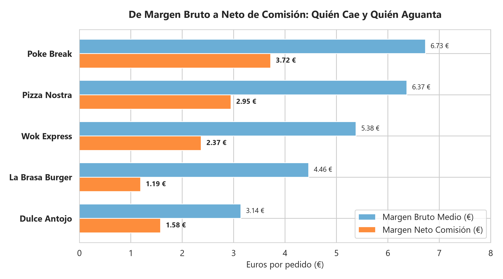
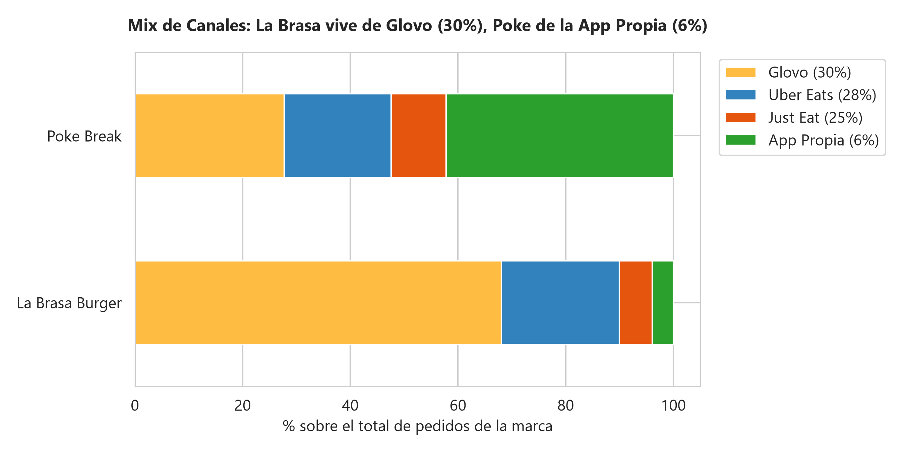
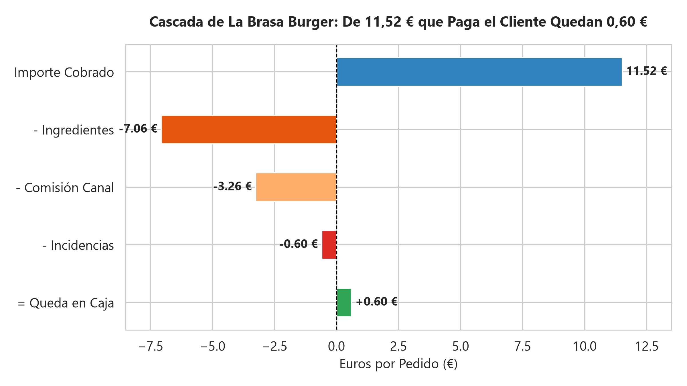
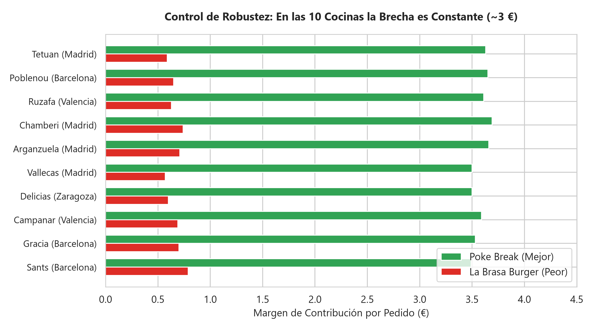
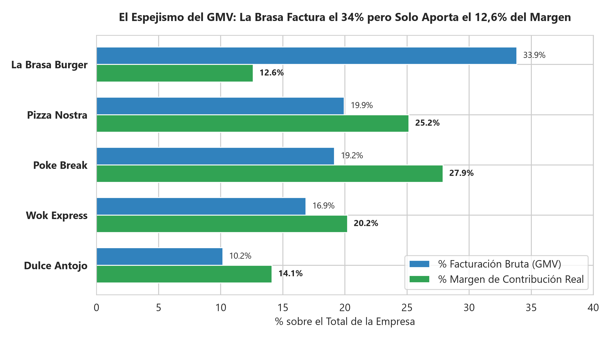
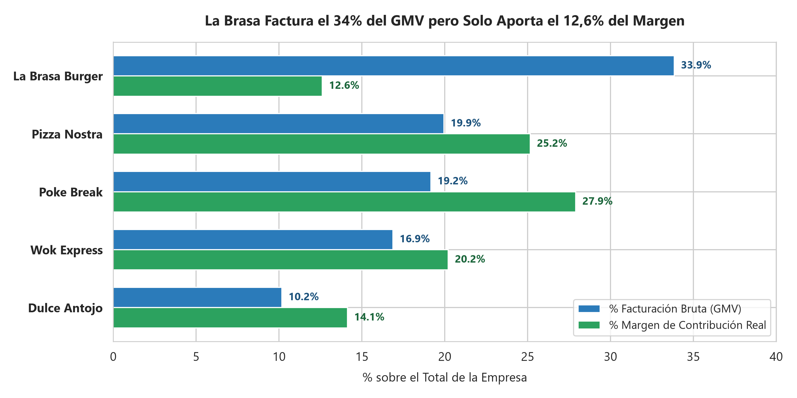
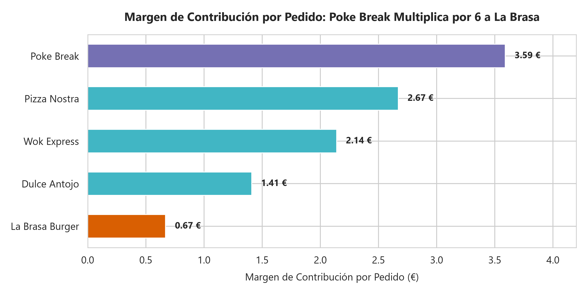
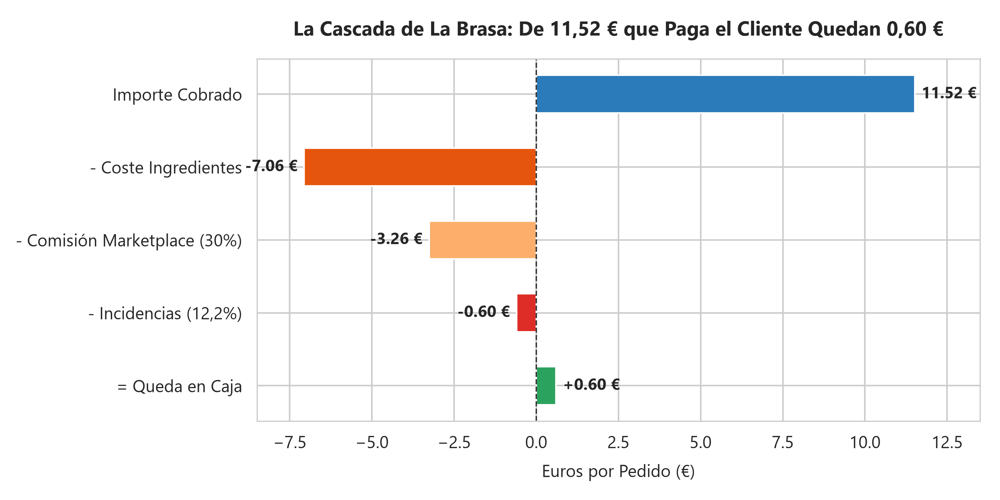
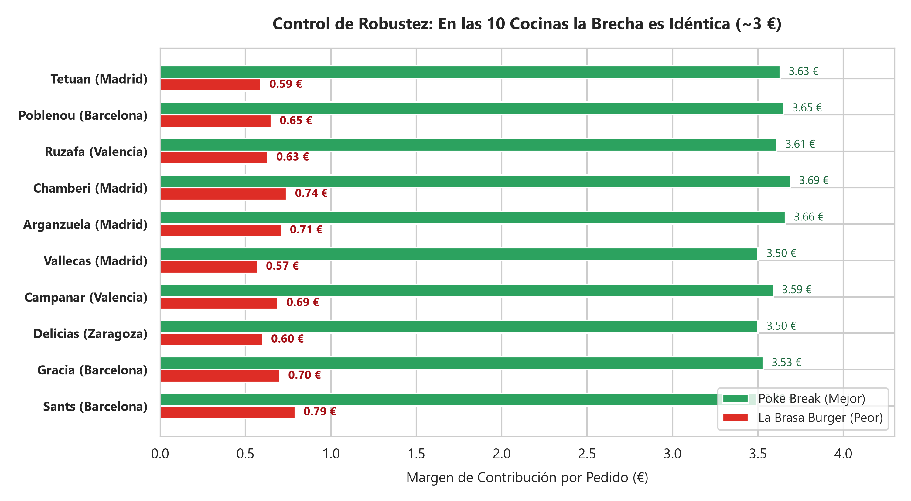

🇲🇽 [Versión en español](README.md)

# RutaSabor — Foodtech / Ghost kitchens (delivery)

**Business question:** Which brand should be scaled in the new kitchens: the one with the highest sales, or the one that leaves the most margin after commissions and incidents?

## Business context

Ghost-kitchen operator with several virtual brands sold through delivery marketplaces, facing an expansion decision.

5-day case study ("real assignment" format): exploration, cleaning, SQL/Python analysis, discovery of the key insight, stress-testing against alternative hypotheses, and executive communication.

## Dataset

Synthetic case data in `data/` (16 CSV files; folders: `data/clean/`, `data/raw/`). `raw/` holds the original data and `clean/` the cleaned tables produced by the notebooks.

## Method (day by day)

| Notebook | Content |
|---|---|
| [`dia_01.ipynb`](dia_01.ipynb) | Day 1: Intake Check and Forensic Data Audit (EDA) |
| [`dia_02.ipynb`](dia_02.ipynb) | Day 2: Clean Before Calculating (and Decide for Yourself What Margin Means) |
| [`dia_03.ipynb`](dia_03.ipynb) | Day 3: The Surface Ranking (Morning) and the First Channel Crack (Afternoon) |
| [`dia_04.ipynb`](dia_04.ipynb) | Day 4: Take Away the Commission and the Incidents: What Is Left of La Brasa? |
| [`dia_05.ipynb`](dia_05.ipynb) | Day 5: Make It Understood and Make It Change Something (Executive Charts and Investment Decision) |

## Key findings

Faithful English translation of the opening section of the executive one-pager ([`reports/ONE_PAGER.md`](reports/ONE_PAGER.md), in Spanish); all figures come from the notebooks:

> ### 1. Grant the point on the surface (Gonzalo is right about what he sees)
> At first glance, and according to the official dashboards (Metabase), **La Brasa Burger is the company's undisputed number one**:
> * **Volume:** It accounts for **50.978 orders** ($33,99\%$ of the whole company).
> * **Gross Sales (GMV):** It generates **587.218 €** ($33,85\%$ of total sales).
> * It comfortably doubles the catalog's second brand in both volume and sales.
> > Gonzalo is not wrong about the surface figures: La Brasa is the queen of the screens.

Structure of the documented findings:

- 1. Grant the point on the surface (Gonzalo is right about what he sees)
- 2. Why that picture is misleading: the delivery trap and hidden costs
- 3. The Finding in Numbers: The GMV Mirage vs. Contribution Share
- 4. The Stress-Test (Robustness Check): It is not the kitchen, it is the brand
- 5. Executive Recommendation in Three Moves

## Charts



















## Tools

Python 3, Pandas, NumPy, DuckDB (SQL), Matplotlib, Seaborn, Jupyter Notebook.

## How to run

```bash
pip install -r ../requirements.txt
cd rutasabor
jupyter notebook
```

Run the notebooks in order (`dia_01` → `dia_05`); paths are relative to this folder. The notebooks already include their outputs, so they can be read directly on GitHub. (Notebooks are in Spanish.)
