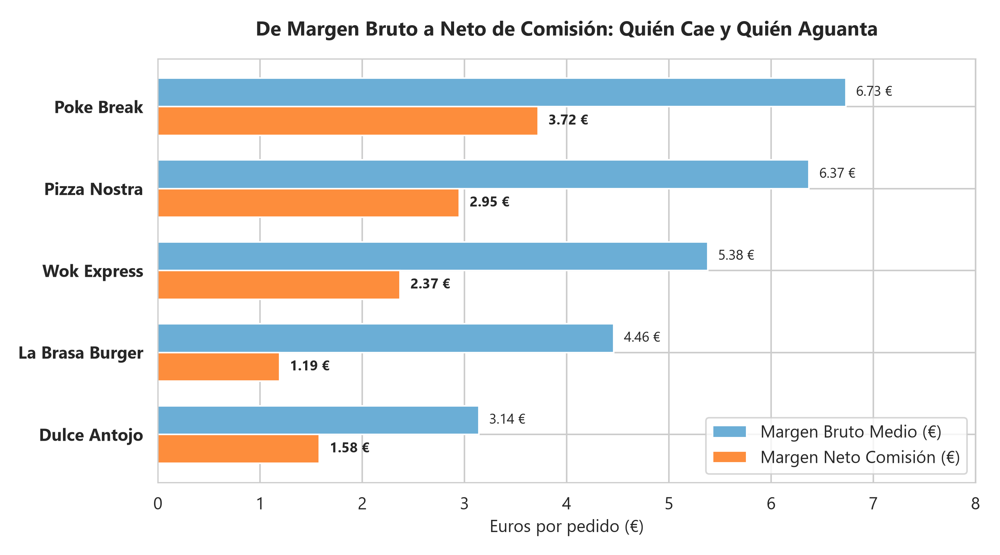
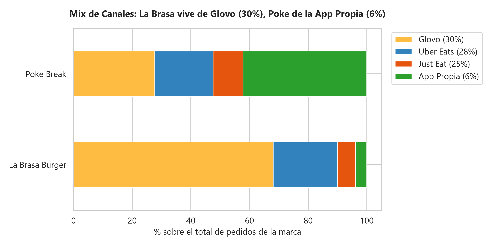
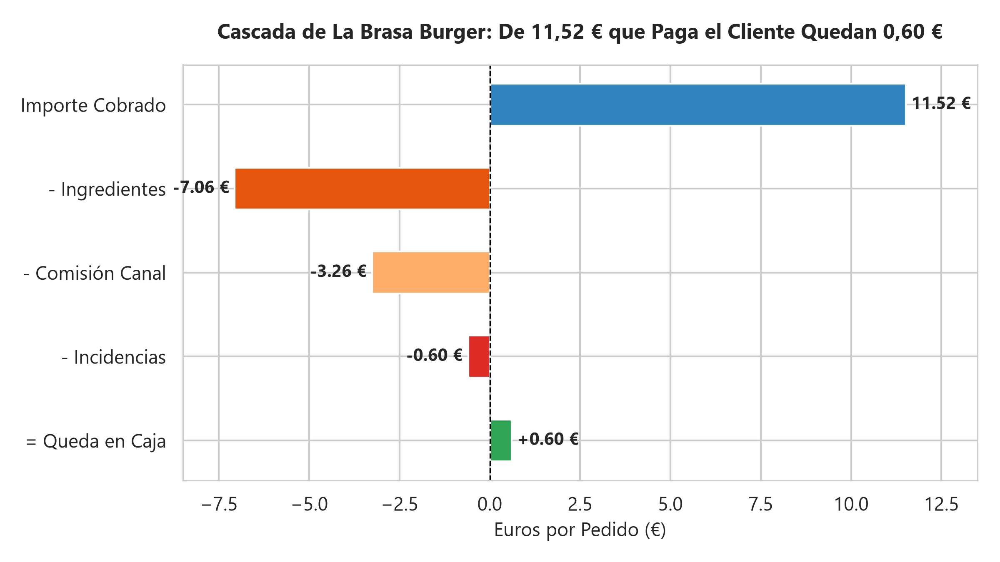
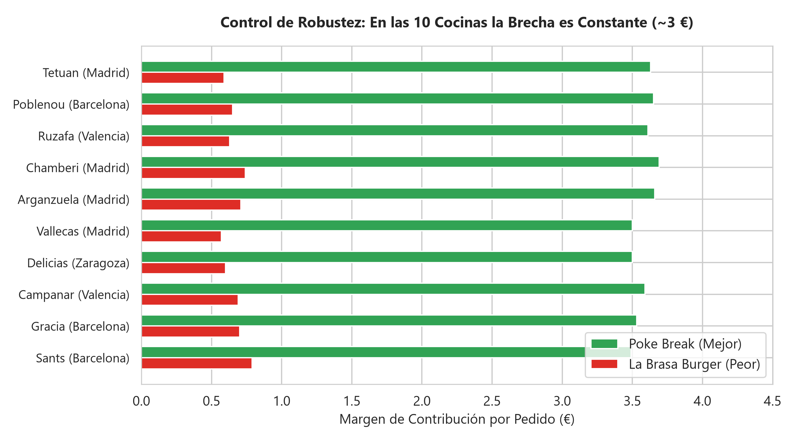
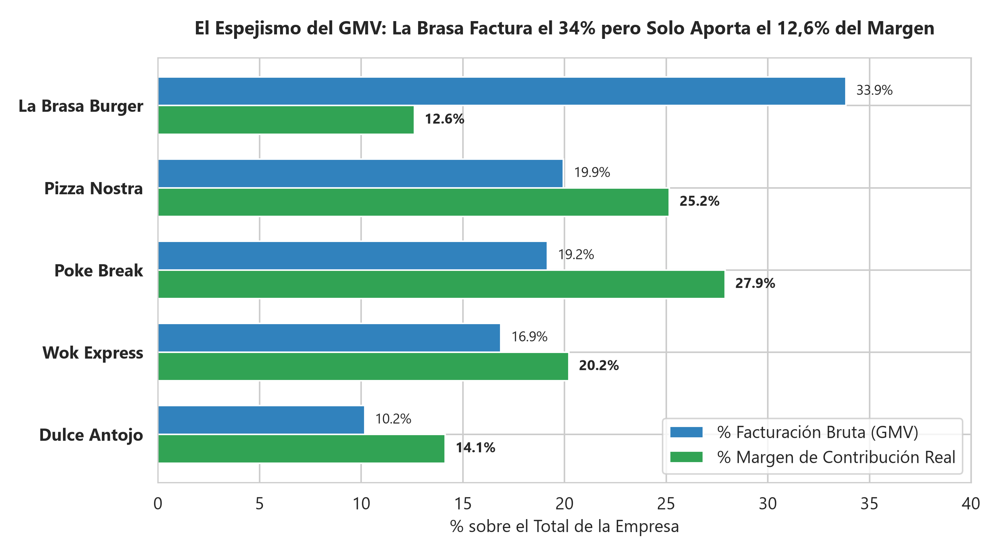
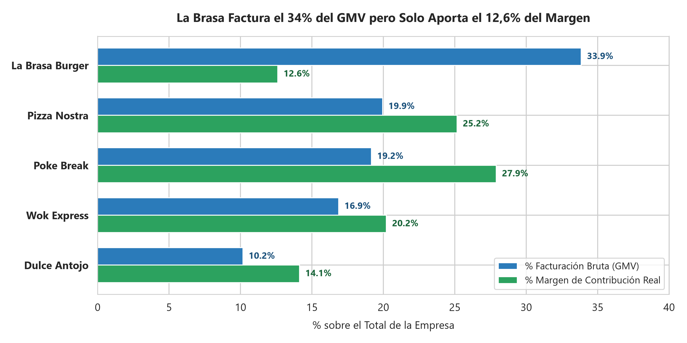
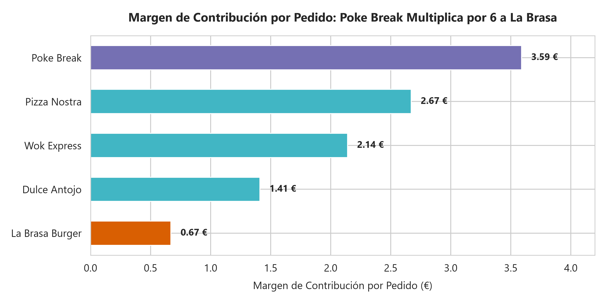
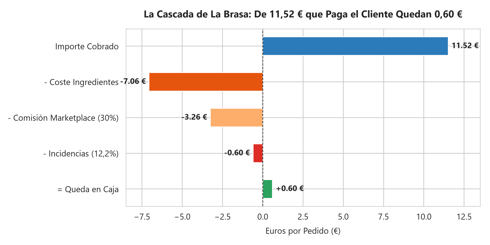
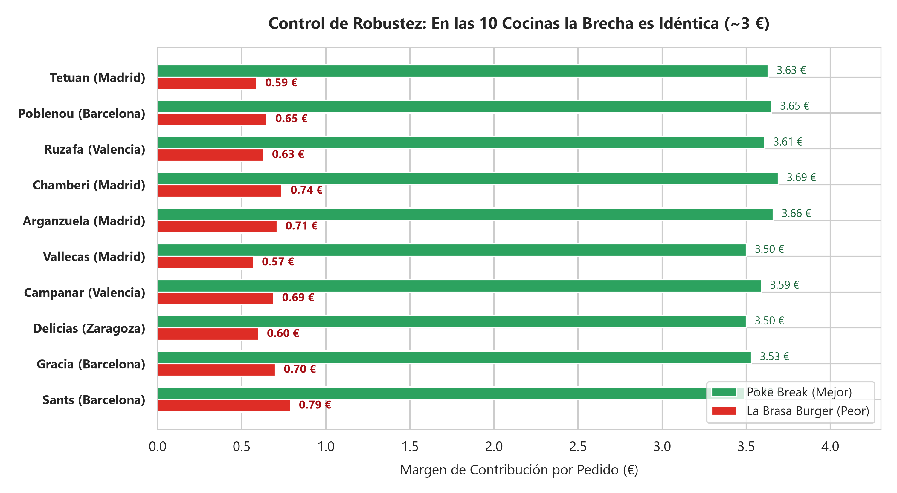

🇬🇧 [English version](README.en.md)

# RutaSabor — Foodtech / Cocinas fantasma (delivery)

**Pregunta de negocio:** ¿Qué marca conviene escalar en las nuevas cocinas: la que más factura o la que más margen deja tras comisiones e incidencias?

## Contexto de negocio

Operador de cocinas fantasma con varias marcas virtuales vendidas por marketplaces de delivery, ante una decisión de expansión.

Caso de estudio de 5 días (formato «encargo real»): exploración, limpieza, análisis en SQL/Python, descubrimiento del hallazgo, blindaje frente a hipótesis alternativas y comunicación ejecutiva.

## Dataset

Datos sintéticos del caso en `data/` (16 ficheros CSV; carpetas: `data/clean/`, `data/raw/`). `raw/` contiene los datos originales y `clean/` las tablas limpias generadas por los cuadernos.

## Método (día a día)

| Cuaderno | Contenido |
|---|---|
| [`dia_01.ipynb`](dia_01.ipynb) | Día 1: Chequeo de Entrada y Auditoría Forense de los Datos (EDA) |
| [`dia_02.ipynb`](dia_02.ipynb) | Día 2: Antes de Calcular, Limpiar (y Decidir tú qué es el Margen) |
| [`dia_03.ipynb`](dia_03.ipynb) | Día 3: El Ranking de Superficie (Mañana) y La Primera Grieta del Canal (Tarde) |
| [`dia_04.ipynb`](dia_04.ipynb) | Día 4: Quítale la Comisión y las Incidencias: ¿Qué Queda de La Brasa? |
| [`dia_05.ipynb`](dia_05.ipynb) | Día 5: Que se Entienda y Cambie Algo (Gráficos Ejecutivos y Decisión de Inversión) |

## Hallazgos clave

Extracto literal del one-pager ejecutivo ([`reports/ONE_PAGER.md`](reports/ONE_PAGER.md)); todas las cifras provienen de los cuadernos:

> ### 1. Dale la razón en la superficie (Gonzalo tiene razón en lo que ve)
> A primera vista y según los cuadros de mando oficiales (Metabase), **La Brasa Burger es la número uno indiscutible de la empresa**:
> * **Volumen:** Concentra **50.978 pedidos** ($33,99\%$ de toda la compañía).
> * **Facturación Bruta (GMV):** Genera **587.218 €** ($33,85\%$ de las ventas totales).
> * Duplica holgadamente en volumen y ventas a la segunda marca del catálogo.
>
> > Gonzalo no se equivoca en las cifras de superficie: La Brasa es la reina de las pantallas.

Estructura de los hallazgos documentados:

- 1. Dale la razón en la superficie (Gonzalo tiene razón en lo que ve)
- 2. Por qué esa foto engaña: La trampa del delivery y los costes ocultos
- 3. El Hallazgo en Números: El Espejismo del GMV vs la Cuota de Contribución
- 4. El Blindaje (Control de Robustez): No es la cocina, es la marca
- 5. Recomendación Ejecutiva en Tres Movimientos

## Gráficos



















## Herramientas

Python 3, Pandas, NumPy, DuckDB (SQL), Matplotlib, Seaborn, Jupyter Notebook.

## Cómo ejecutar

```bash
pip install -r ../requirements.txt
cd rutasabor
jupyter notebook
```

Ejecuta los cuadernos en orden (`dia_01` → `dia_05`); las rutas son relativas a esta carpeta. Los cuadernos ya incluyen sus salidas, por lo que se pueden leer directamente en GitHub.
