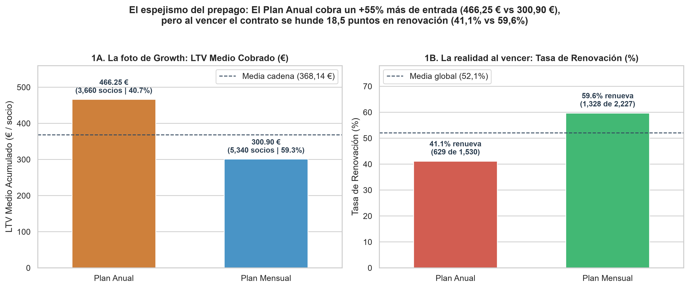
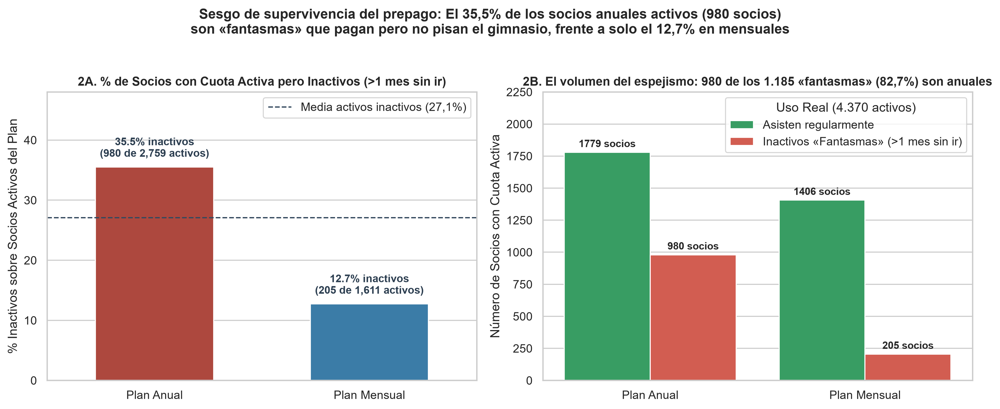
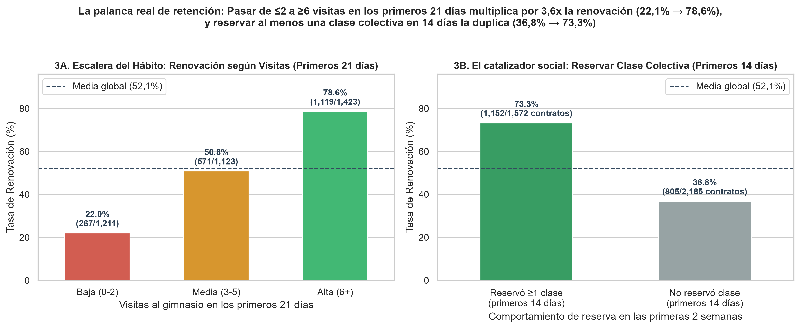
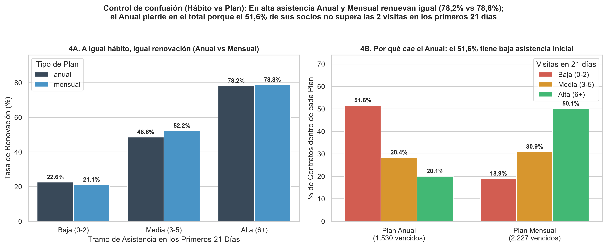

🇲🇽 [Versión en español](README.md)

# VueltaFit — Fitness / Gyms

**Business question:** Which plan (annual or monthly) generates more money in the long run, and which lever explains renewal?

## Business context

Gym chain pushing the "Pásate al Anual" (Switch to Annual) campaign that wants to know whether the annual plan retains and renews better.

5-day case study ("real assignment" format): exploration, cleaning, SQL/Python analysis, discovery of the key insight, stress-testing against alternative hypotheses, and executive communication.

## Dataset

Synthetic case data in `data/` (14 CSV files; folders: `data/clean/`, `data/raw/`). `raw/` holds the original data and `clean/` the cleaned tables produced by the notebooks.

## Method (day by day)

| Notebook | Content |
|---|---|
| [`dia_01.ipynb`](dia_01.ipynb) | Day 1: Welcome to the Business and First Contact with the Data (EDA) |
| [`dia_02.ipynb`](dia_02.ipynb) | Day 2 (morning): Systematic Data Cleaning and Definition of Renewal |
| [`dia_03.ipynb`](dia_03.ipynb) | Day 3 (Wednesday): The First Crack — The Annual Plan Renews Worse |
| [`dia_04.ipynb`](dia_04.ipynb) | Day 4 (Thursday): Pay for the Year and Come Back the Next? Habit and Robustness Check |
| [`dia_05.ipynb`](dia_05.ipynb) | Day 5 (Friday) — Make it understood and make it change something (Executive Visualizations and One-Pager for Marta) |

## Key findings

Faithful English translation of the opening section of the executive one-pager ([`reports/ONE_PAGER.md`](reports/ONE_PAGER.md), in Spanish); all figures come from the notebooks:

> ## 1. Executive Summary (In one sentence)
> The **annual plan** looks like the star product on the Growth dashboards because it records an **average collected LTV $+55,0\%$ higher than the monthly plan** (**$466,25\text{ €}$ versus $300,90\text{ €}$**, concentrating **$51,5\%$ of cumulative revenue** with **$40,7\%$ of members**), but that initial advantage is a **prepayment mirage**: **$35,5\%$ of annual members with an active fee ($980$ of $2.759$) are "ghost members"** who have not set foot in the gym for over a month (almost triple the **$12,7\%$** of the monthly plan), and at expiry their **renewal rate drops to $41,1\%$ versus $59,6\%$ for monthly ($-18,5\text{ pp}$)**, showing that retention is not bought by the contract type but by **building the habit in the first 21 days** —those who attend **$\ge 6$ times renew at $78,6\%$** (and renew exactly the same on annual [**$78,2\%$**] as on monthly [**$78,8\%$**]) versus only **$22,1\%$** of those who attend $0\text{--}2$ times, the bracket where **$51,6\%$ of annual members** are stuck—.

Structure of the documented findings:

- 1. Executive Summary (In one sentence)
- 2. The Three Key Findings
- Finding 1 — Rubén is right about the day-1 snapshot: the annual plan wins on upfront cash due to the prepayment effect
- Finding 2 — When crossed with expiry and turnstile data, the ranking flips due to Survivorship Bias
- Finding 3 — The lever that decides renewal: the Habit Ladder in the first 21 days and the 1st Group Class
- 3. Master Results Tables
- 4. Stress-Testing the Finding: Confounding Control and Ruled-Out Hypotheses
- 5. Actionable Recommendation for the Committee
- 6. Supporting Charts in `reports/`

## Charts









## Tools

Python 3, Pandas, NumPy, DuckDB (SQL), Matplotlib, Seaborn, Jupyter Notebook.

## How to run

```bash
pip install -r ../requirements.txt
cd vueltafit
jupyter notebook
```

Run the notebooks in order (`dia_01` → `dia_05`); paths are relative to this folder. The notebooks already include their outputs, so they can be read directly on GitHub. (Notebooks are in Spanish.)
