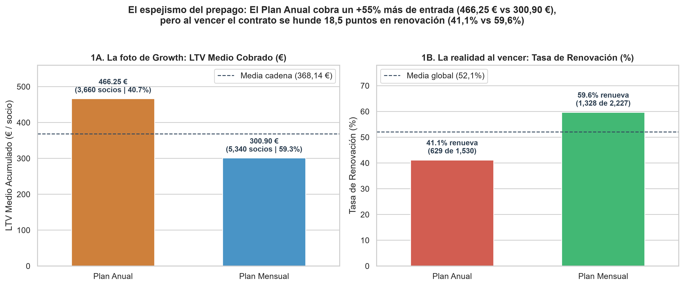
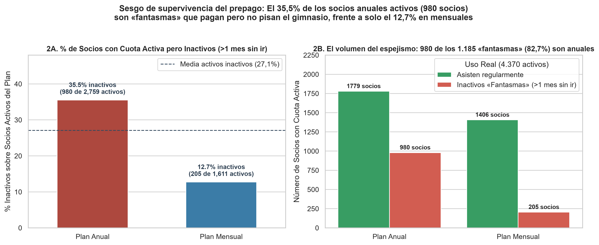
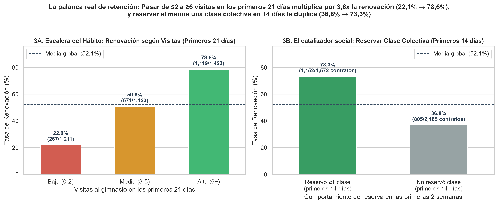
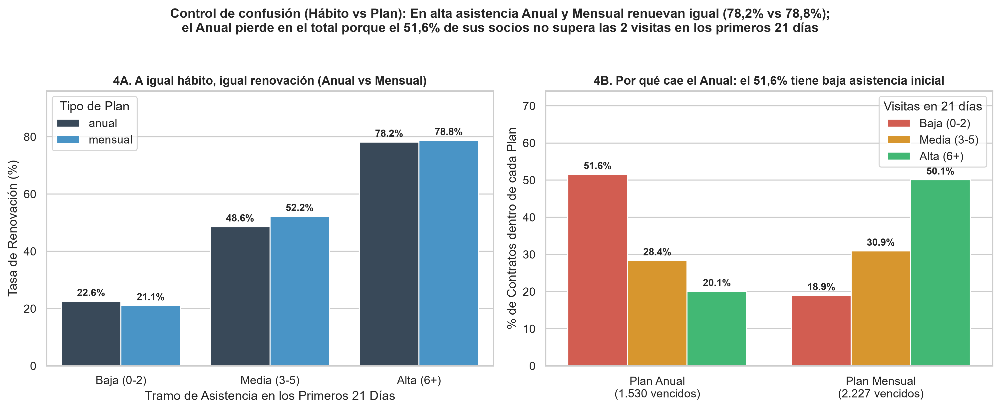

🇬🇧 [English version](README.en.md)

# VueltaFit — Fitness / Gimnasios

**Pregunta de negocio:** ¿Qué plan (anual o mensual) deja más dinero a largo plazo y qué palanca explica la renovación?

## Contexto de negocio

Cadena de gimnasios que impulsa la campaña «Pásate al Anual» y quiere saber si el plan anual retiene y renueva mejor.

Caso de estudio de 5 días (formato «encargo real»): exploración, limpieza, análisis en SQL/Python, descubrimiento del hallazgo, blindaje frente a hipótesis alternativas y comunicación ejecutiva.

## Dataset

Datos sintéticos del caso en `data/` (14 ficheros CSV; carpetas: `data/clean/`, `data/raw/`). `raw/` contiene los datos originales y `clean/` las tablas limpias generadas por los cuadernos.

## Método (día a día)

| Cuaderno | Contenido |
|---|---|
| [`dia_01.ipynb`](dia_01.ipynb) | Día 1: Bienvenida al Negocio y Primer Contacto con los Datos (EDA) |
| [`dia_02.ipynb`](dia_02.ipynb) | Día 2 (mañana): Limpieza Sistemática de Datos y Definición de Renovación |
| [`dia_03.ipynb`](dia_03.ipynb) | Día 3 (miércoles): La Primera Grieta — El Anual Renueva Peor |
| [`dia_04.ipynb`](dia_04.ipynb) | Día 4 (jueves): ¿Paga el Año y Vuelve el Siguiente? El Hábito y el Control de Robustez |
| [`dia_05.ipynb`](dia_05.ipynb) | Día 5 (viernes) — Que se entienda y cambie algo (Visualizaciones Ejecutivas y One-Pager para Marta) |

## Hallazgos clave

Extracto literal del one-pager ejecutivo ([`reports/ONE_PAGER.md`](reports/ONE_PAGER.md)); todas las cifras provienen de los cuadernos:

> ## 1. Resumen Ejecutivo (En una frase)
> El **plan anual** parece el producto estrella en los cuadros de mando de Growth porque registra un **LTV medio cobrado un $+55,0\%$ superior al mensual** (**$466,25\text{ €}$ frente a $300,90\text{ €}$**, concentrando el **$51,5\%$ de los ingresos acumulados** con el **$40,7\%$ de los socios**), pero esa ventaja inicial es un **espejismo del prepago**: el **$35,5\%$ de los socios anuales con cuota activa ($980$ de $2.759$) son «socios fantasma»** que llevan más de un mes sin pisar el gimnasio (casi el triple que el **$12,7\%$** del plan mensual) y al llegar el vencimiento su **tasa de renovación cae al $41,1\%$ frente al $59,6\%$ del mensual ($-18,5\text{ pp}$)**, demostrando que la retención no la compra el tipo de contrato sino **consolidar el hábito en los primeros 21 días** —quienes asisten **$\ge 6$ veces renuevan al $78,6\%$** (y renuevan exactamente igual en anual [**$78,2\%$**] que en mensual [**$78,8\%$**]) frente a solo el **$22,1\%$** de quienes asisten $0\text{--}2$ veces, tramo en el que queda atrapado el **$51,6\%$ de los socios anuales**—.

Estructura de los hallazgos documentados:

- 1. Resumen Ejecutivo (En una frase)
- 2. Los Tres Hallazgos Clave
- Hallazgo 1 — Rubén tiene razón en la foto del día 1: el plan anual gana en caja inicial por el efecto prepago
- Hallazgo 2 — Al cruzar con el vencimiento y los torniquetes, el ranking se invierte por el Sesgo de Supervivencia
- Hallazgo 3 — La palanca que decide la renovación: la Escalera del Hábito en los primeros 21 días y la 1ª Clase Colectiva
- 3. Tablas Maestras de Resultados
- 4. Blindaje del Hallazgo: Control de Confusión e Hipótesis Descartadas
- 5. Recomendación Accionable para el Comité
- 6. Gráficos de Soporte en `reports/`

## Gráficos









## Herramientas

Python 3, Pandas, NumPy, DuckDB (SQL), Matplotlib, Seaborn, Jupyter Notebook.

## Cómo ejecutar

```bash
pip install -r ../requirements.txt
cd vueltafit
jupyter notebook
```

Ejecuta los cuadernos en orden (`dia_01` → `dia_05`); las rutas son relativas a esta carpeta. Los cuadernos ya incluyen sus salidas, por lo que se pueden leer directamente en GitHub.
